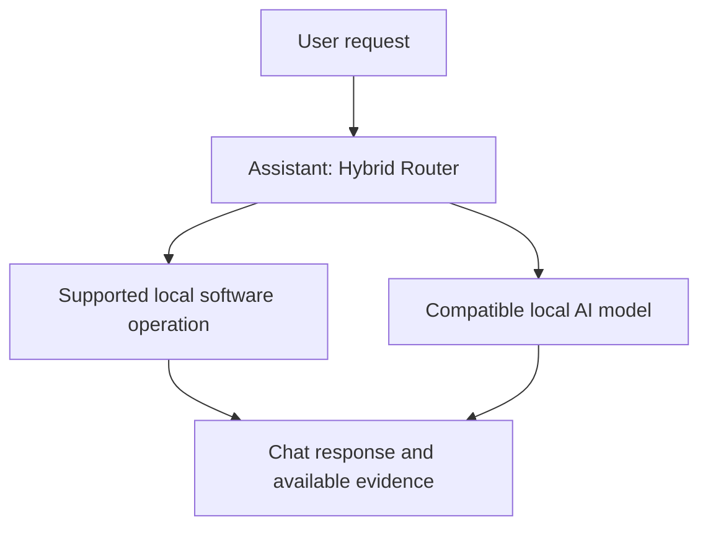

<p align="center">
  
</p>

<h1 align="center">SIAAS Personal</h1>

<p align="center">
  <strong>Your AI, in your hands.</strong><br>
  Configure your own AI environment without building it from scratch.
</p>

SIAAS Personal is a free, open-source, local-first desktop AI platform.
It brings local models, specialized assistants, knowledge and software
capabilities together in one configurable workspace.

An agentic harness is the software around an AI model that manages context,
tools and execution. SIAAS provides that environment as a desktop application:
configure your own projects and assistants instead of developing your own
integration. Use local software for supported deterministic tasks and local AI
for language understanding, interpretation and generation.

[Official website](https://siaas.vercel.app/) ·
[Get started from source](#getting-started) ·
[Installation from releases](#installation-from-releases) ·
[English documentation](https://siaas.vercel.app/documentation/en/introduction) ·
[Documentazione italiana](https://siaas.vercel.app/documentation/it/introduction) ·
[Latest stable release](https://github.com/siaas-software/siaas-personal/releases/latest) ·
[Release candidate](https://github.com/siaas-software/siaas-personal/releases/tag/v1.1.0-rc.5)

<a id="product-principles"></a>

## Why SIAAS?

- **Configure, rather than build.** Organize assistants, instructions, knowledge
  and supported tools without developing your own agentic infrastructure.
- **Software + AI.** Use supported deterministic software operations when
  possible and a suitable local model when needed.
- **Privacy by design.** Ordinary local processing and workspace storage stay
  on your computer.
- **Resource-conscious.** Select compatible models for your hardware or use
  supported model-free operations. A dedicated GPU is optional.
- **Free and open source.** Normal local use requires no SIAAS account, paid AI
  API or Docker. Original application code is licensed under MIT.

## Main Features

This overview covers the published feature set through **v1.1.0-rc.5**.
The latest stable release is **v1.0.0**; stable installation and updates exclude
prereleases. Select the published candidate explicitly for its additional
capabilities.

### Release availability

| Capability | Stable v1.0.0 | v1.1.0-rc.5 |
| --- | --- | --- |
| Projects, assistants, local Ollama chat, Knowledge, Actions and Data Cell | Available | Available |
| Structured Data Analysis and automatic CSV/XLSX preparation | Not included | Available |
| Hybrid Router and supported model-free execution | Not included | Available |
| Native read-only List Sources Action | Not included | Available |
| Configured sequential multi-assistant project chat | Not included | Available |
| Bundled templates and semantic palettes | Three templates; no semantic palettes | Six templates with semantic palettes |
| Optional Advanced Reasoning and Advanced Web Research | Beta, off by default | Beta, off by default |

See the [stable release notes](https://github.com/siaas-software/siaas-personal/releases/tag/v1.0.0)
and [candidate release notes and readiness assets](https://github.com/siaas-software/siaas-personal/releases/tag/v1.1.0-rc.5)
for exact scope and testing limitations. The candidate passed its executable
automated gates. Native desktop acceptance across platforms, real Ollama
acceptance and matched hardware benchmarks remain separate checks.

| Feature | What you can do |
| --- | --- |
| Projects and assistants | Organize activities into projects with separate assistant roles, instructions, models and authorized sources. |
| Knowledge and retrieval | Import supported PDF, DOCX, TXT or Markdown, link folders and prepare public web snapshots. Keyword retrieval can work without embeddings for supported prepared text; embeddings enable semantic retrieval. |
| Chat and local models | Ask questions, draft reports and explain results with a suitable local Ollama model. |
| Hybrid Router | Use the same chat for supported deterministic operations and model-assisted execution. |
| Structured Data Analysis | Prepare CSV/XLSX datasets, compute supported totals, comparisons and grouped results, and inspect source evidence. |
| Project chat | Optionally coordinate existing assistants in a configured sequence, with separate history, progress and cancellation. |
| Actions and Data Cell | Reuse prompt-based Actions or invoke the native read-only List Sources Action without a model. Data Cell requests a table, not a verified spreadsheet calculation. |
| Templates | Start with reusable project configurations and customize assistants, sources and models. |
| Models and Overview | Choose and download models, inspect loaded models and available computer resource readings. |

### Software + AI

Each assistant has its own Hybrid Router. Direct assistant chat and delegated
project-chat requests use the same execution service.



Supported arithmetic, bounded structured data queries, keyword retrieval over
prepared local sources and native List Sources can run without a selected
model, embeddings or an inference request.

For example, with a prepared budget dataset containing a unique sheet and an
unambiguous numeric column, ask:

```text
What is the total budget in budgets.csv?
Show the result, currency, and number of rows used in the calculation.
```

Clear rectangular CSV/XLSX files can be prepared automatically. Ambiguous
mappings, cached formula results and cross-file relationships require
confirmation. Missing values are not silently treated as zero. More complex
plans can use the query editor or compatible local model-assisted planning.
Rejected plans and timeouts do not produce unverified calculations.
See [Structured Data Analysis](https://github.com/siaas-software/siaas-personal/blob/v1.1.0-rc.5/docs/structured-data-analysis.md).

### Configured multi-assistant workflows

Project orchestration is optional and disabled by default. Select existing
assistants in execution order (up to eight steps). Each retains its own router,
instructions, model and authorized resources. Previous-result text sharing
is separately opt-in and does not grant additional access.

For example, a purchasing project can use a data analyst to calculate shortages
from prepared order and stock datasets, followed by a report assistant to explain
the results with a suitable local model. This is configured sequential
execution, not autonomous model-driven delegation.

Tool-capable local agent eligibility depends on a compatible runtime and Ollama
metadata reporting both `completion` and `tools`, not a parameter-count
threshold. Eligibility does not guarantee reliable tool selection.

AI answers can be wrong. Inspect sources, assumptions and important conclusions.
PDF text extraction is supported; scanned PDFs need external OCR.
PDF filling is not implemented.

## How It Works

**Project → Assistants → Optional Knowledge → Chat**

1. **Create a project.** Organize an activity in a dedicated workspace or start
   from a template.
2. **Create your assistants.** Define roles and instructions. Select a compatible
   local model when the task needs one.
3. **Connect your knowledge.** Add files, linked folders or public web sources
   to the relevant assistant. Wait for preparation to finish.
4. **Start a conversation.** Ask a question and inspect available evidence.
   Enable configured project orchestration only when needed.

SIAAS checks for a compatible Ollama service, reuses it where possible and
can offer a managed installation on supported targets. Knowledge preparation
does not retrain your model. Supported local operations can work offline once
their inputs and any required models are ready. Website consultation requires
connectivity.

<a id="supported-platforms"></a>

## Requirements

### Platforms and hardware

The source distribution targets **Windows, macOS and Linux**, on **x64 and arm64**.
Electron requires a graphical desktop. Distribution targets do not establish
native acceptance on every platform; consult the selected release's notes.

Start with about **8 GB RAM and 10 GB free disk space** for small models.
These are practical starting recommendations, not guaranteed minimums.
Larger models, builds and optional modules may need more resources.
A dedicated GPU is optional; performance depends on hardware, model and task.
Internet access is required for installation and model downloads.

### Source development prerequisites

- **Node.js and npm:** use Node.js **24.22.0**, pinned in [runtime.json](runtime.json),
  to match the distribution. [package.json](package.json) declares Node.js
  >=22.16.0; desktop packaging needs Node.js 24+ for Zstandard.
- **Git:** clone the repository and select the published release tag.
- **Electron/native dependencies:** Linux needs Electron system libraries and
  a graphical session; native builds may need the OS compiler toolchain.
- **Release bootstrap tools:** PowerShell 5.1+ and archive tools on Windows;
  Bash, curl, tar, unzip and sha256sum or shasum on macOS/Linux.
  The managed installer provisions its own Node.js/npm and does not require Git.

### Ollama and models

For local inference, use a compatible Ollama service (minimum **0.11.10** in the
[published manifest](https://github.com/siaas-software/siaas-personal/blob/v1.1.0-rc.5/desktop/ollama-assets.json)).
Managed downloads cover only the listed targets; other targets need a
compatible external installation. Select models per assistant.
Semantic retrieval can use a local embedding model; supported keyword
preparation does not require it. Supported model-free operations need no
running inference service.

## Optional Components

<a id="funzionalità-sperimentali-opzionali"></a>
<a id="funzionalita-sperimentali-opzionali"></a>
<a id="optional-experimental-features"></a>

**Advanced Reasoning (Beta)** and **Advanced Web Research (Beta)** are
independent optional modules, disabled by default. Their supported stacks
require Docker. Web discovery additionally requires explicit assistant-level
consent. Normal chat, Knowledge, configured website consultation and supported
deterministic operations do not require Docker.

For configuration, prerequisites, privacy and troubleshooting:
[Research guide — English](docs/research-en.md) ·
[Guida alla ricerca — Italiano](docs/research-it.md).

<a id="quick-start"></a>
<a id="development"></a>

## Getting Started

### From source

Run the exact published candidate from source:

```bash
git clone --branch v1.1.0-rc.5 https://github.com/siaas-software/siaas-personal.git
cd siaas-personal
npm ci
npm run desktop:dev
```

For the stable release, use `--branch v1.0.0` instead. A tag checkout is
detached; create a working branch for changes. Keep test data separate from
valuable work. Manual source checkouts do not inherit managed release updates.

`desktop:dev` builds and launches Electron; rerun it after source changes.
`npm run dev` alone is the web-only entry point, not the desktop application.

Follow the [first conversation walkthrough](https://siaas.vercel.app/documentation/en/quickstart)
for everyday use.

### Development checks

Run relevant checks from the selected source version:

```bash
npm test
npm run typecheck
npm run build
npm run desktop:build
```

Use targeted regressions for the modified subsystem. For real local AI behavior,
run `npm run ollama:test` with a compatible local service and required models.
Simulated services do not establish native installation, real-model or Docker
Beta acceptance. Documentation-only changes require Markdown, link and factual
checks. See the [developer reference](https://github.com/siaas-software/siaas-personal/blob/v1.1.0-rc.5/docs/developer-reference.md).

<a id="installation"></a>

## Installation from Releases

Use [Get started](https://siaas.vercel.app/get-started) and the
[installation guide](https://siaas.vercel.app/documentation/en/installation).

The published distribution uses a **source installer**: download verified
release files, provision a private Node.js runtime, build the application and
register a launcher. There is no separate published EXE or DMG installer.
No global Node.js, npm or Git installation is needed for this route.

The installer provisions Node.js 24.22.0 without changing global Node.js or NVM.
Review official scripts before running them and follow OS security controls.

**Stable channel — Windows (PowerShell):**

```powershell
irm https://siaas.vercel.app/install.ps1 | iex
```

**Stable channel — macOS or Linux (Terminal):**

```bash
curl -fsSL https://siaas.vercel.app/install.sh -o install-siaas.sh
bash install-siaas.sh
```

Open SIAAS Personal from the Windows Start menu or Linux application menu;
on macOS, open `~/Applications/SIAAS Personal.command`.

These commands select the stable channel through the website's download service.
If unavailable, consult the [stable release assets](https://github.com/siaas-software/siaas-personal/releases/tag/v1.0.0).
Do not bypass integrity checks or substitute automatically generated source archives.

**Release candidate:** use the official
[v1.1.0-rc.5 release assets](https://github.com/siaas-software/siaas-personal/releases/tag/v1.1.0-rc.5).
Download and inspect `install-rc.ps1` or `install-rc.sh`, verify its published
SHA-256 digest, and explicitly set `SIAAS_RELEASE_TAG=v1.1.0-rc.5` before running
the appropriate script. Keep candidate installation and data profiles separate
from stable. Consult the candidate release notes and readiness assets.

SIAAS CLI is a separate optional command-line utility:
[official CLI repository](https://github.com/siaas-software/siaas-cli) ·
[CLI installation guide](https://siaas.vercel.app/documentation/en/cli-installation).
Consult its own release notes for supported lifecycle operations and platforms.

### Updates and existing workspaces

Use **Settings → Application updates** for stable updates. Back up the complete
data directory with the application closed, and back up linked originals
separately. Rollback restores an application version, not an earlier database.
The supplied uninstall scripts remove launcher registration while preserving
versions and data.

See [installation and recovery](docs/installation-en.md) and the
[migration guide](docs/migration-en.md). The previous repository's v1.2.0
updater does not migrate to this repository. Preserve your data backup and
follow the documented migration procedure.

## Templates

The published candidate bundles six starting configurations from the
[official template repository](https://github.com/siaas-software/siaas-templates).

| Template | Useful for | Palette |
| --- | --- | --- |
| Computer Science Study | Programming, algorithms and TypeScript. | Sky |
| Production Planning | Orders, inventory and material requirements. | Slate |
| Personal Finance | Transactions, budgets and savings, with currency-aware analysis. | Mint |
| Construction Cost Analysis | Estimates, quantities and cost variances. | Peach |
| Technical Documentation | Technical source review, reports and site minutes. | Lavender |
| Materials & Procurement | Material lists, quotations and procurement gaps. | Aqua |

Stable v1.0.0 bundles Computer Science Study, Home Gardening and Software
Engineering. Choose a compatible application version for each template.

Open **Templates**, select **Use template**, configure assistant models and
connect your own knowledge. Import a compatible official template or save and
share your own project configuration without editing JSON manually.

Templates contain configuration and configured public URLs, not your documents,
conversations or installed models. Review text and URLs before sharing.
Importing a template cannot add unsupported application capabilities.
Existing projects and customized templates remain separate from bundled presets.

Templates organize work; they do not supply missing data or replace professional
review.

<a id="local-ai-and-models"></a>

## Privacy and Local AI

Ordinary local inference, retrieval and workspace storage stay on your computer.
No paid cloud inference provider is required. Protect your operating-system
account and backups; local storage is not a promise of encryption.

Network access occurs when installing or updating software, downloading models,
importing or refreshing web sources, or consulting authorized websites.
Some templates include public URLs. Optional Advanced Web Research sends queries
derived from the question to external search services. Privacy filters are not
guaranteed anonymization; avoid confidential questions when enabling discovery.

Consult [sources and research](docs/research-en.md) and
[local data and backups](https://siaas.vercel.app/documentation/en/data).

## Documentation

- **User guides:** [English](https://siaas.vercel.app/documentation/en/introduction)
  and [Italiano](https://siaas.vercel.app/documentation/it/introduction).
- **Installation and troubleshooting:** [installation](https://siaas.vercel.app/documentation/en/installation)
  and [troubleshooting](https://siaas.vercel.app/documentation/en/troubleshooting).
- **Candidate technical references:**
  [Structured Data Analysis](https://github.com/siaas-software/siaas-personal/blob/v1.1.0-rc.5/docs/structured-data-analysis.md),
  [Project Chat](https://github.com/siaas-software/siaas-personal/blob/v1.1.0-rc.5/docs/project-chat-rc5.md),
  [model eligibility](https://github.com/siaas-software/siaas-personal/blob/v1.1.0-rc.5/docs/agent-model-eligibility.md).
- **Actions and optional research:** Actions ([EN](docs/actions-en.md) /
  [IT](docs/actions-it.md)), research ([EN](docs/research-en.md) /
  [IT](docs/research-it.md)).
- **Installation and migration:** installation ([EN](docs/installation-en.md) /
  [IT](docs/installation-it.md)), migration ([EN](docs/migration-en.md) /
  [IT](docs/migration-it.md)).
- **Releases:** [latest stable](https://github.com/siaas-software/siaas-personal/releases/latest)
  and [published releases and candidates](https://github.com/siaas-software/siaas-personal/releases).

Website documentation and historical repository guides may describe a different
version. Check release notes for exact compatibility and testing limitations.

<a id="open-source-and-contributing"></a>

## Contributing and License

Bug reports, documentation improvements and code contributions are welcome.
Include your OS, application version, reproduction steps and a sanitized error
message when [reporting a problem](https://github.com/siaas-software/siaas-personal/issues).
See [CONTRIBUTING.md](CONTRIBUTING.md) for GitFlow and pull request requirements.

### License

Original SIAAS Personal code is licensed under the [MIT License](LICENSE).
Copyright © 2026 Davide Abbatiello. Third-party components, model weights and
referenced websites retain their own terms; see [third-party notices](THIRD_PARTY_NOTICES.md)
and [open-source licenses](docs/open-source-licenses.md).
