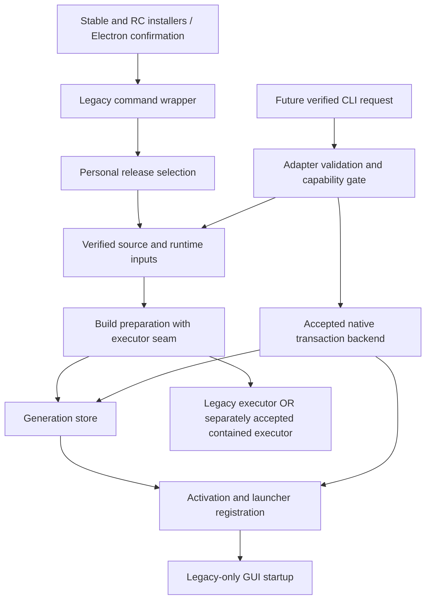

# Installer Adapter v1 — bounded technical feasibility spike

Date: 2026-11-09. **Installer Adapter v1 is NOT READY.** No platform is advertised
as conformant. This investigation tests isolated mechanisms, not an installer or release.
The [prototype and reproduction guide](../../experiments/installer-adapter-feasibility/README.md)
and its evidence distinguish passing assertions from failed security hypotheses.

## Baseline and scope

- Fresh develop / inspected Personal engine: `17202c5964d9282efd4a1991c548612287c65dbb`.
- PR #23 reference: `c3567cc0b574d77a95e13b48f19fde42045cab8d`.
  Read its [audit](https://github.com/siaas-software/siaas-personal/blob/c3567cc0b574d77a95e13b48f19fde42045cab8d/docs/audits/personal-cli-separation.md),
  [normative contract](https://github.com/siaas-software/siaas-personal/blob/c3567cc0b574d77a95e13b48f19fde42045cab8d/docs/design/installer-adapter-v1.md),
  [roadmap](https://github.com/siaas-software/siaas-personal/blob/c3567cc0b574d77a95e13b48f19fde42045cab8d/docs/design/installer-adapter-v1-roadmap.md),
  all eight schemas, 89 indexed fixtures, 12 semantic scenarios and validation procedure.
  Replayed its documented validation before switching branches: PASS, 48 valid,
  29 schema-negative and 12 parser-negative fixtures. This is design-shape evidence only.
- PR #20 head: `1496298a6619708e56bba1b1a2d08c0b542b2d80`;
  PR #21 head: `9ea36d30c7b5adcfad0ce5c53ec5a3aee7d7c647`.
  All three PRs remain draft; no commits/edits made to them. Their baseline updatedAt
  values are 2026-11-07T07:56:32Z, 2026-11-07T13:01:47Z and
  2026-11-09T19:48:04Z respectively; compare at delivery.
- Spike branch starts directly from develop; PR #23 is neither merged nor copied.
  Production scripts/installers, source-manager, tests, dependencies and workflows are untouched.
- Native CI strategy inspected: four files under `.github/workflows` have `.disabled`
  suffixes. No permitted active native test runner was available; none was enabled.

Host: Linux x86_64, kernel 6.18.57, UID 1000, Python 3.12.14, Node 24.19.0,
npm 11.9.0. Node differs from RC3's 24.22.0 distribution pin; no real RC build is claimed.
Capabilities effective=0, NoNewPrivs=1, seccomp mode=2. `/tmp` is tmpfs; `/workspace`
is overlay with a distinct device ID (34 vs 27 during this run). Cgroup hierarchy is
not writable; no user scope bus variables available. These observations apply to this
managed container, not all Linux installations. No sudo/escalation, package installation,
security setting changes or access to real Personal data occurred.

Classification: **VERIFIED** = observed narrowly specified experimental behavior;
**FAILED** = tested candidate does not satisfy the property; **BLOCKED** = an available
host prerequisite prevents the experiment; **NOT RUN** = no native execution evidence.
PASS/FAIL below describe experiment assertions or the tested property explicitly.

## Process/network experiments

Common preconditions: ordinary Linux x64 user; temp roots owned by that user; local-only
fixture socket permitted. Commands run from repository root. No real secrets are passed.

| ID / command | Expected property | Observed / result / classification | Limitation and action |
| --- | --- | --- | --- |
| C1 `python experiments/installer-adapter-feasibility/probe_containment.py` (unshare) | User/mount/net/PID namespaces start isolated marker child | Exit 1, `/proc/self/uid_map` read-only; marker absent. **BLOCKED** | No namespace network/FS/process acceptance. Fail closed; obtain a separately authorized native host with supported unprivileged namespaces. Do not alter this host's restrictions. |
| C2 same command (bwrap) | User/net namespace with read-only root and temp bind | Exit 1, UID map read-only; marker absent. **BLOCKED** | bwrap presence is not usable isolation. No elevated retry. |
| C3 same command (systemd-run) | User scope can own a process tree | Exit 1, user bus unavailable; marker absent; cgroup not writable. **BLOCKED** | Scope alone would not provide all filesystem/network/GUI controls even if available. |
| C4 `python experiments/installer-adapter-feasibility/spike.py Spike.test_01_environment_allowlist` | Child gets only explicit PATH/LANG plus Python locale normalization | PASS; no other inherited keys. **VERIFIED** | Environment construction only; does not block reading credentials from files/sockets or imply containment. |
| C5 `python experiments/installer-adapter-feasibility/spike.py Spike.test_02_cooperative_group_cancel_and_escape` | Negative control: setsid descendant escapes group signal; unrelated sibling survives | Assertions PASS; escaped child alive, sibling untouched, fixture parent cleans child. Group-only security hypothesis **FAILED** | Do not use process groups as an adversarial tree boundary. Need kernel-enforced non-breakaway membership and kill/reap semantics. |
| C6 `python experiments/installer-adapter-feasibility/spike.py Spike.test_03_npm_lifecycle_environment_is_not_containment` | Negative control: env allowlist and npm offline flag do not contain lifecycle | Assertions PASS; npm prepare writes sibling TEMP marker, starts marker subprocess and connects loopback. Env/offline-only security hypothesis **FAILED** | No actual GUI started. Proves arbitrary child execution still possible, not native Electron launch. Need enforceable writes/network/exec policy. |

C1 expands to `unshare --user --map-root-user --mount --net --pid --fork <python>
-c <temporary marker writer>`; C2 uses `bwrap --unshare-user --unshare-net --ro-bind /
/ --bind <temp> <temp> -- <same marker writer>`; C3 uses `systemd-run --user --scope
--quiet <same marker writer>`. The committed script is the exact reproducible command
construction, using temporary absolute paths. Logs preserve diagnostic text and exit codes.
No network-denial claim is inferred from the managed Cloud destination proxy, a missing
DISPLAY, successful environment filtering or failed namespace construction.

## Filesystem and recovery experiments

Commands share prefix `python experiments/installer-adapter-feasibility/spike.py` followed
by the exact selector below. All run Linux x64 as UID 1000 on new temporary directories.
No test executes an installed app, opens SQLite, or registers an actual desktop launcher.

| ID / exact selector | Expected / observed | Result / classification | Practical limit |
| --- | --- | --- | --- |
| F1 `Spike.test_04_flock_exclusion_and_sigkill_release` | Second process rejected while lock held; SIGKILL releases OS lock even though lock file remains | PASS / **VERIFIED** | Advisory cooperative lock, no PID-based stale deletion; inode replacement/hostile same-user writes not solved |
| F2 `Spike.test_05_two_process_generation_cas` | Two expected-revision=0 writers serialize; one commits, one conflicts; revision=1 | PASS / **VERIFIED** | Toy local counter under flock; no persistent generation allocator acceptance |
| F3 `Spike.test_06_sigkill_at_nine_activation_boundaries` | Kill after intent, generation move, commit record, gate, launcher, pointer, activation record, gate release and receipt; recover twice converges | PASS, nine subcases / **VERIFIED** | Roll-forward toy model. Corrupt backups, compensation, interrupted recovery and real gated launchers need separate tests |
| F4 `Spike.test_07_receipt_failure_preserves_activation` | Receipt path is a directory; write fails after activation; journal still says activated; later recovery writes receipt | PASS / **VERIFIED** | EISDIR fixture, not native ACL or disk-exhaustion test; illustrates nonzero completion without undoing activation fact |
| F5 `Spike.test_08_corrupt_and_truncated_journal_fail_closed` | Malformed tail or wrong hash chain rejected before pointer changes | PASS, two subcases / **VERIFIED** | Conservative refusal; does not implement normative reconciliation of a safe truncated tail |
| F6 `Spike.test_09_handle_relative_nofollow` | Reject symlink directory; held directory FD survives pathname swap and does not follow replacement link | PASS / **VERIFIED** | Controlled Linux swap only; full ancestry ownership, openat2 policy, mount races, Windows reparse and macOS equivalents untested |
| F7 `Spike.test_10_cross_volume_launcher` | Cross-device rename fails EXDEV; separate launcher replacement and pointer recovery converge after kill | PASS / **VERIFIED** | `/tmp` and `/workspace` distinct devices; tmpfs/overlay, not persistent physical disks |
| F8 `Spike.test_11_installed_generation_corruption_rejected` | Modified generation marker causes recovery refusal; old pointer remains | PASS / **VERIFIED** | Constant toy byte comparison, not production manifest, signature, complete-file-set or ACL verification |
| F9 `Spike.test_12_atomic_single_file_replace_readers` | Reader sees only full old/new 8192-byte values over 50 replacements | PASS / **VERIFIED** | Observed single-file namespace replacement; not proof against device power loss or every filesystem |

Full command `python experiments/installer-adapter-feasibility/spike.py`: **12 tests PASS**,
including negative controls. Two early fixture defects (npm config double-load and socket
EOF wait) were fixed; final rerun is recorded. They were harness failures, not production
failures. The prototype's primitives are deliberately smaller than PR #23's schemas;
passing them does not change the status of its 12 unimplemented semantic scenarios.

### Atomicity, durability and recoverability are different

**Atomicity — VERIFIED in limited observation:** each same-volume replace exposes old or
new file content. At the launcher kill point the launcher is new while current is old:
that deliberately observed mixed state disproves multi-file atomic activation. A gate is
required, but the toy gate's integration with a real launcher is NOT RUN.

**Durability — BLOCKED for production acceptance:** fsync calls on files/directories
returned successfully, but tmpfs and managed overlay storage do not demonstrate survival
of power loss, controller caches or persistent ext4/NTFS/APFS semantics. SIGKILL leaves
the kernel/page cache alive. Need native persistent-volume fault-injection/VM power-cut
acceptance, filesystem support policy and platform-specific flush justification.

**Recoverability — VERIFIED only for listed toy crashes:** journal-driven roll-forward
and idempotent re-entry recover the controlled interruptions. The model refuses corrupt
records and preserves successful activation when receipt writing fails. It does not
implement complete ownership validation, durable backup sets, restore-previous compensation,
concurrent launch gates or recovery interrupted at each write. Those remain BLOCKED for
production readiness; no actual installation or user data was used to test them.

## Per-platform feasibility and deployment requirements

| Platform | Native status | Mechanisms worth evaluating / requirements | Unresolved mandatory guarantees |
| --- | --- | --- | --- |
| Linux x64 | Narrow primitives **VERIFIED**; full containment **BLOCKED** here | Supported unprivileged user/mount/net/PID namespaces plus cgroup delegation; private FS view, safe handle-based access, broker-only downloads, explicit executable policy | Namespace/cgroup unavailable in this container. Need anti-escape child accounting, no direct network, bounded downloaded executables, GUI/IPC denial, native persistent recovery |
| Linux arm64 | **NOT RUN**; no native host | Same design, native arm64 kernel/toolchain and dependency coverage; verify namespaces/cgroups are permitted, not just compiled in | No inference from x64 tests; process/fs/network/native build matrix all pending |
| Windows x64 | **NOT RUN**; no native host | Job Objects with kill-on-close/no breakaway, suspended creation then assignment; restricted token/AppContainer or equivalent reviewed broker; WFP or broker-only networking; ACL/handle-based IO | Job Object alone is not filesystem/network isolation; descendant escape, npm compatibility, required privileges, reparse defense, sharing violations and FlushFileBuffers/replace recovery unverified |
| Windows arm64 | **NOT RUN**; no native host | Same native Windows controls, arm64 toolchain and explicit emulation policy | Native binary/signature/download coverage, inherited handles and all x64 requirements unverified |
| macOS x64 | **NOT RUN**; no native host | Supported signed sandbox helper or isolated VM/build worker with mediated downloads and private FS; supported cancellation/ownership design | Do not rely on private/deprecated sandbox-exec interfaces or assume a process group confines descendants. npm/child execution, entitlements, app startup denial, signing/quarantine and APFS persistence unresolved |
| macOS arm64 | **NOT RUN**; no native host | Same supported isolation strategy, native arm64 tools and translated-process rejection | Entitlements, quarantine, architecture-specific downloads and all native recovery guarantees unverified |

None of these candidates grants permission to install a privileged service or change host
settings. An implementation needing a broker/helper/VM must document deployment, signing,
permissions, upgrades and availability, and fail BUILD_POLICY_UNAVAILABLE when absent.
No elevated operation was attempted. The macOS mechanism remains a design choice, not an
experimentally justified implementation path. Windows Job Objects can help own processes,
but additional controls are mandatory; likewise Linux namespaces are not the entire policy.

The build trust boundary includes npm lifecycle scripts, Electron/builder binary fetches
and the Node license fetch in `scripts/prepare-package.mjs:85–91`. “npm offline” and a
release hash cannot constrain those actions. A broker must authenticate content and deny
unapproved direct connections; build children must have no credentials, host GUI sockets,
profile access, journal write access or unapproved execution. A text domain allowlist is
not enforcement. Same-user/administrator tampering is outside the draft's accepted threat
model, but accidental writes and untrusted dependency side effects must still be contained.

## Smallest engine extraction and dependency map

Classification: **VERIFIED by source inspection**, not by a refactored build. References
below use baseline [source-manager.mjs](https://github.com/siaas-software/siaas-personal/blob/17202c5964d9282efd4a1991c548612287c65dbb/scripts/source-manager.mjs#L1).
No production files were edited. The existing helpers already separate some concerns;
extract orchestration seams rather than introducing another package/installation engine.

| Proposed internal boundary | Current evidence | Minimal change in a separately authorized refactor |
| --- | --- | --- |
| `release-selection` | source-manager:197–207, 343–353; scripts/lib/distribution.mjs:81–183 | Reuse resolveManifest/validateManifest; legacy selects stable or caller manifest, future adapter receives already resolved target. No CLI product catalog in Personal. |
| `verified-inputs` | manager:220,227–260; managed-runtime.mjs:20–73,112–187 | Reuse verified downloads/runtime helpers; inject explicit paths/platform and return verified input records. Adapter later adds provenance, safe extraction, full toolchain coverage. |
| `build-preparation` | manager:51–62,265–289; build-desktop.mjs; prepare-package.mjs | Extract command plan/executor seam returning built generation. Legacy executor preserves current commands/env/stdout; future contained executor is separate and unavailable until accepted. |
| `generation-store` | manager:221–225,290–315,161–188 | Stage and retain generation/manager/runtime; preserve old layout and cleanup behavior on legacy path. New integrity/journal/GC policy must not silently change legacy semantics. |
| `activation` | manager:83–140,316–327 | Isolate pointer/launcher/dispatcher/runtime-path effects from building and GUI startup. Preserve exception compensation as-is in initial extraction; do not relabel it durable recovery. |
| `startup` | manager:141–160,328,339–341 | Separate launch(item) from activation result. Preserve new-install launch and same-version early return (213–217) in legacy wrapper; adapter never calls startup. |
| `legacy-command-wrapper` | manager:333–423; install.sh:38–48/install.ps1:37–51; RC equivalents; update/rollback/uninstall wrappers | Keep argv/env parsing, status behavior, lock/errors, bootstrap and update-detached PID wait unchanged. Inject context/reporter internally; retain installed release's manager dispatcher. |
| `future-transaction-backend` | No equivalent complete implementation; atomicWrite at 131–134 is narrower | Add only after native proof: durable journal, ownership/CAS, gate, receipts and recovery. Must not wrap current behavior and claim the normative contract is satisfied. |

The future branch in this diagram is a proposal, not current reachability. CLI remains
responsible for product resolution/acquisition/orchestration and user-facing errors;
Personal owns build/install/activation/profile/launcher/recovery. The old manager's
`main()` top-level call, globals and root creation need a thin CLI wrapper so importing
an internal library does not install, launch, resolve network metadata or create a root.
Pass an immutable context and injected runner/reporter; avoid broad “command string” hooks.

### Compatibility invariants

- Stable shell/PowerShell installers keep stable discovery, managed runtime bootstrap,
  existing default roots and manual GUI launch behavior. RC installers keep explicit
  SIAAS_RELEASE_TAG, RC defaults/profile separation and prepared source inputs.
- Existing launcher paths, persisted current/previous manager matching and legacy `SIAAS`
  Electron userData location remain unchanged. No automatic ownership/adoption/migration.
- Same-version legacy retry still returns without a new GUI launch; new install's
  completed message/activation/startup ordering stays observable as before until a
  separately reviewed behavior change. Do not accidentally launch twice after extraction.
- Electron native update confirmation and sender checks remain at desktop/main.cjs:263–289;
  only confirmed update follows the existing detached manager flow. Library extraction
  cannot expose a renderer bypass or remove the application quiescence requirement.
- Legacy rollback/uninstall remain legacy behavior; not new adapter capabilities.
  Future adapter rejects RC3/unknown capability rather than patching released managers.
  RC2, RC3 and stable artifacts/tags are immutable and outside this work.

## Blockers, resolutions and proposed sequence

| Finding | Classification | Required resolution |
| --- | --- | --- |
| Env allowlist / npm offline are insufficient confinement | **FAILED** | Replace env-only policy with native write/network/exec containment plus authenticated download broker; preserve env allowlist as one defense |
| Process-group-only owned-tree cancellation | **FAILED** | Prove non-breakaway kernel ownership and descendant reap/termination on each native target; fixture cleanup is not that proof |
| Linux namespace/cgroup/user-scope prerequisites here | **BLOCKED** | Use separately authorized compatible native test host; do not weaken container policy or escalate |
| Native Windows/macOS/arm64 execution | **NOT RUN** | Obtain respective native hosts; run dependency/lifecycle hostile fixtures and platform IO tests before advertising support |
| Persistent power-loss durability / safe multi-file recovery | **BLOCKED** | Define supported local filesystems; native crash/power-cut tests, gate enforcement, backup integrity and compensation interrupted at every boundary |
| Directory FD/no-follow, cooperative lock/CAS, controlled roll-forward | **VERIFIED** | Useful prototype evidence only; extend to complete ancestor ownership, generation manifests, aliases/reparse points and journal semantics |
| Real GUI/app-start prevention during arbitrary build execution | **NOT RUN** | Define allowed build executables/entry points and deny host GUI/IPC access; prove with native probes. Mock marker is only a negative control |
| Source-level extraction seams | **VERIFIED** | May be refactored independently under behavior-preserving characterization tests; not a capability/readiness claim |

Recommended minimum viable work, in order:

1. Review these findings against PR #23 without editing or merging it. Keep all targets
   blocked for adapter support. Decide a supported native enforcement backend per target.
2. A separately authorized **behavior-preserving engine extraction can begin independently**
   of unresolved native containment. Add characterization tests for exact legacy commands,
   phase order, errors, same-version return, new-install launch, RC roots/profile and native
   confirmation dispatch. Keep only the old wrapper reachable; no adapter entry point,
   descriptor capability, new filesystem transaction or install-only promise in this step.
3. Prototype native containment and durable transaction backends in isolation. Expand this
   toy model to the normative journal/receipt/installed-manifest schemas, compensation,
   interrupted recovery, receipt ACL/disk errors and concurrency with a real guarded launcher.
4. Connect a future adapter only to accepted native backends. If none is available, discovery
   is blocked and prepare refuses before build scripts. Initially advertise only a native
   target with complete evidence; none qualifies today. Windows/macOS/arm64 cannot inherit
   Linux results. Prepared verified inputs do not waive build execution trust requirements.
5. Preserve manual workflows and run legacy regression/native acceptance. Interoperate with
   CLI in separately authorized work; no standalone CLI repository changes here. Future
   release publication requires its own authorization and acceptance, not this spike.

This recommendation refines the sequencing question in PR #23: its G3 currently follows
G1/G2. The spike proposes splitting G3 into a **legacy-only pure extraction** (can precede
those gates) and **adapter/backend integration** (cannot). This is a review recommendation,
not an amendment to PR #23 or permission to weaken its mandatory gates. A full install-only
engine is still BLOCKED; only source factoring and mocks are independently feasible.

## Validation and evidence boundaries

[Linux test log](../../experiments/installer-adapter-feasibility/evidence/linux-x64-tests.txt):
12/12 assertions PASS, no skips in the recorded host run, including nine SIGKILL boundaries,
two journal negatives and negative containment controls. [Prerequisite probe log](../../experiments/installer-adapter-feasibility/evidence/linux-x64-containment.jsonl):
all three entry points BLOCKED before marker child execution. Probe script returns success
for collecting evidence, not for achieving confinement; inspect per-record classification.

Documentation link checks, Python syntax parsing, `git diff --check`, exact production-tree
comparison against the develop baseline and read-only PR head/updatedAt checks are delivery
checks. No actual installer, application build, model, profile, release, workflow or
standalone CLI was changed or executed. No native acceptance was inferred from schemas,
source inspection, library availability or tests on a different OS/architecture.
