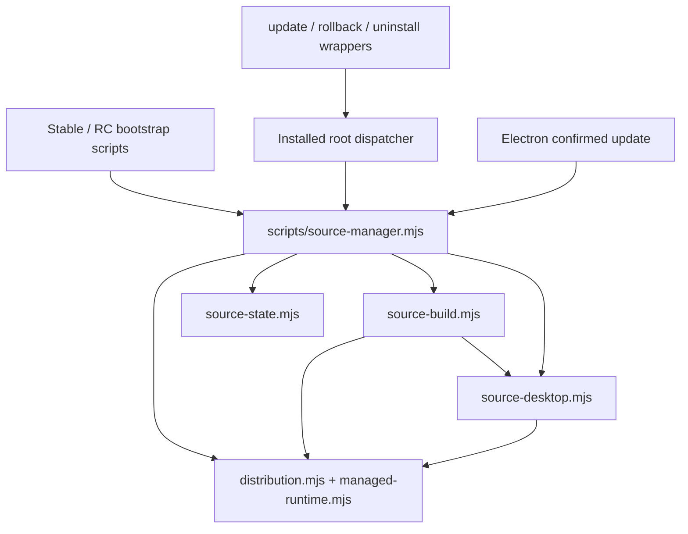

# Personal installation engine extraction — Phase 1

Follow-up: [native regression acceptance](personal-installation-engine-phase1-native.md)
records fresh sandbox-enabled Electron attempts and remaining host/platform blockers.
The baseline results below remain the original extraction evidence.

## Scope and baseline

This is a behavior-preserving extraction of the **legacy Personal source manager**.
It does not implement Installer Adapter v1, expose discovery or install-only
operations, add a product resolver, or change the standalone SIAAS CLI.

Inspected `develop`: `17202c5964d9282efd4a1991c548612287c65dbb`.
Inspected `main`: `04bd232d27cbbaa8317a3ba8444ddedaa0e92a1e` (default branch).
Work branch: `refactor/personal-installation-engine-phase1`.
Validation host: Linux x64, Node **24.22.0**, 2026-11-10 UTC. Dependencies were
installed with `npm ci` from the unchanged committed lockfile.

The resumed workspace contained only the untracked characterization test; no
production edits or phase-specific commit existed. It was preserved, extended
with isolation/input-corruption/launcher-failure cases, and run before production
changes. Typecheck, all application/distribution/installer tests, seven
characterization cases and the desktop build passed on the original manager.
Prior interrupted-run logs were not used as evidence for this baseline.

Reviewed references, without merging or editing their branches:

| PR | Inspected head | Relevance |
| --- | --- | --- |
| [#20](https://github.com/siaas-software/siaas-personal/pull/20) | `1496298a6619708e56bba1b1a2d08c0b542b2d80` | Separate Electron test infrastructure |
| [#21](https://github.com/siaas-software/siaas-personal/pull/21) | `9ea36d30c7b5adcfad0ce5c53ec5a3aee7d7c647` | Separate lifecycle audit |
| [#23](https://github.com/siaas-software/siaas-personal/pull/23) | `c3567cc0b574d77a95e13b48f19fde42045cab8d` | Normative adapter design; native gates remain blocked |
| [#24](https://github.com/siaas-software/siaas-personal/pull/24) | `6a15b7f067d0e44106763d9e90561498449e3e33` | Permits a separately reviewed legacy extraction before adapter containment work |

These heads and their `updated_at` values were unchanged at preflight. GitHub
read-only checks reported active branch/tag rulesets. No setting, protected ref,
existing PR, published asset, installation or actual profile is modified here.

## Call graph and internal boundaries



The dispatcher selects the **active generation's own** manager, which imports
that generation's adjacent libraries. Old retained monolithic managers continue
to execute without needing the new modules. New generations contain the whole
`scripts` directory in the source archive (`release-source.mjs` uses `git archive`).
Copying only the new entry-point file is not a supported deployment method.

| File | Responsibility | Deliberately retained coupling |
| --- | --- | --- |
| [source-manager.mjs](../../scripts/source-manager.mjs) | Existing argv/actions, progress, manifest selection, runtime provisioning, stage allocation, commit/activation ordering, dispatcher, lock, rollback/uninstall and detached-update wait | Still the only legacy command entry point; new installation still calls GUI launch |
| [source-state.mjs](../../scripts/lib/source-state.mjs) | Root/path defaults, installed record, folder checks, current.json replacement, previous snapshot and existing retention cleanup | Reads the existing environment; current/previous layout and cleanup rules unchanged; no journal, CAS or adoption |
| [source-build.mjs](../../scripts/lib/source-build.mjs) | Source download/hash/size check, extraction, package/runtime agreement, npm/build commands and executable check | Uses the existing runtime environment, inherited stdio and synchronous subprocess policy; **not a contained build executor** |
| [source-desktop.mjs](../../scripts/lib/source-desktop.mjs) | Executable lookup, launcher contents/destinations, runtime-path registration and detached application startup | Launcher destination still reads current.json; uses the same runtime verification and profile argument |

Factories only capture the legacy root/functions. Importing the three libraries
and constructing their contexts creates no installation directory and performs
no install/launch. No extensible command runner or alternate public parser was
introduced. The executable lookup is shared between build and rollback/launch.

All moved function bodies were checked against the baseline, unchanged except
for nesting indentation. The remaining orchestration is unchanged except for
replacing the inline preparation/build block with `await buildSource(...)`.
Distribution/runtime helpers, bootstrap and lifecycle scripts, Electron code,
package/lockfile, application source, workflows and release machinery are unchanged.

## Observable compatibility and evidence

The [characterization suite](../../tests/source-manager-characterization.test.mjs)
loads the original manager with `git show` at the pinned baseline SHA, then runs
the same fixtures against the working manager. It compares stdout, stderr, exit
status, progress order, metadata, launcher/dispatcher bytes, npm argv/cwd/environment
and GUI-child argv. Only temporary root names, generation timestamps and the copied
Node binary hash are normalized. Real zip/unzip, Node children and filesystem IO
are used; npm, electron-builder and the application executable are **fixtures**.
Their output is deterministic. This does not establish real native GUI acceptance.

| Behavior | Result / evidence |
| --- | --- |
| Fresh install | PASS: checking/runtime/downloading/installing/building/completed, metadata/launcher registration, exactly one fixture app launch |
| Repeat install | PASS: runtime verified, launcher refreshed, same metadata and `Already installed`, no build or extra launch |
| Update / downgrade | PASS: update activates and launches; existing source-manager regression refuses automatic downgrade |
| Rollback / dispatcher | PASS: new-to-old and old-to-new retained managers; unchanged metadata/dispatcher bytes; rollback does not launch or reverse data migrations |
| Stable/RC separation | PASS: explicit separate roots sharing the simulated home retain stable registration/data when candidate is installed/uninstalled; RC profile remains root/profile |
| Existing profile/launcher paths | PASS: Linux runtime fixtures; Windows/macOS **platform-branch simulation only**; existing product identity tests preserve default `SIAAS` userData and explicit profile |
| Args / environment / subprocesses | PASS: unknown legacy option still ignored; no adapter capability command; managed npm argv, prefix sanitization, cwd, inherited build output, detached launch args preserved |
| Uninstall | PASS: removes selected launcher/current.json, retains app generations and data; exact messages/status compared |
| Failure / interruption | PASS: failed build, missing app, invalid PID, busy lock, corrupt archive size/hash, registration failure and SIGKILL interruption; no active metadata replacement on tested failures |
| Retention | PASS: existing source-manager regression keeps matching current/previous and removes eligible older generations; no new cleanup policy |
| Electron update confirmation | Existing update/preload and product-identity tests PASS; native confirmation/quit interaction NOT RUN. Unchanged trusted-sender, native confirmation and detached PID flow inspected in desktop/main.cjs |
| Bootstrap / lifecycle shell and PowerShell wrappers | Unchanged source and argument forwarding inspected; real network bootstrap and native wrapper end-to-end installation NOT RUN |
| Download / network / build policy | Same calls, ordering, validators, environment and command bodies; distribution tests PASS. Full live source/runtime/bootstrap download plus native Electron packaging NOT RUN |

### Existing limitations intentionally preserved

- A SIGKILL during build leaves the legacy lock and stage. Retry refuses a busy
  lock; there is no new automatic stale-lock removal or recovery protocol.
- Launcher-registration failure restores prior metadata, but may leave the built
  generation on disk. Restoring the old launcher can itself fail. Pointer rename,
  launcher registration and runtime-path writes are not a multi-file transaction
  and carry no new power-loss durability guarantee.
- After candidate uninstall removes current.json, a second **direct** uninstall
  falls back to the stable launcher path. This pre-existing hazard is characterized,
  not silently fixed. Any correction needs separately scoped behavior-change review.
- Same-version retry verifies the managed runtime, not full installed-application
  integrity. Prepared source verification does not sandbox npm lifecycle/build code.
- An explicit custom root can override stable/RC defaults; there is no new channel
  collision prevention, automatic adoption, migration or profile cleanup.
- Completion progress still precedes GUI startup. A later startup failure retains
  the original legacy semantics; no adapter completion receipt is synthesized.

## Reproduction and baseline comparison

Run from repository root with Node 24.22.0, zip/unzip and installed locked dependencies.
The characterization suite requires the baseline git object; a shallow checkout
must obtain that exact commit first. All its installation/profile fixtures are
temporary directories and it never invokes Electron. Linux is required for the
black-box integration cases; skips on other hosts are not native acceptance.

```sh
npm ci
npm run typecheck -- --incremental false
npm test
npm run test:distribution
npm run test:installer
node --test tests/source-manager-characterization.test.mjs
npm run desktop:build
git diff --check
```

For an independent baseline rerun, use a separate disposable checkout at the
baseline SHA, copy only the characterization test into it and install its locked
dependencies. Do not reset a working checkout or invoke actual user installations.
The differential suite on this branch also executes that original manager directly.
The desktop build regenerates only ignored build output; it does not launch or publish.

| Command | Original baseline | Refactored |
| --- | --- | --- |
| `npm run typecheck -- --incremental false` | PASS | PASS |
| `npm test` | PASS, 175/175 | PASS, 175/175 |
| `npm run test:distribution` | PASS, 16/16 | PASS, 16/16 |
| `npm run test:installer` | PASS, 4/4 | PASS, 4/4 |
| `node --test tests/source-manager-characterization.test.mjs` | PASS, 7/7 | PASS, 7/7 |
| `npm run desktop:build` (includes templates check) | PASS | PASS |
| `npm run test:ui` | BLOCKED | BLOCKED |
| `npm run test:desktop` | BLOCKED | BLOCKED |
| Native Windows/macOS/arm64 installation/launch | NOT RUN | NOT RUN |

`npm test` includes source rollback, product identity and update/preload tests;
`test:distribution` includes source-manager integration. `test:installer` tests the
Ollama installer, not the source bootstrap wrappers. Counts overlap; they must not
be presented as a total of unique tests. Structured records and the complete
characterization outputs are in [the evidence directory](../evidence/engine-phase1/validation.json).

Browser prerequisites were actually probed with `chromiumSandbox: true`: the
matching Playwright binary is absent; `/usr/bin/chromium` aborts with the SUID
sandbox-helper configuration error. Existing UI scripts explicitly pass
`--no-sandbox`, so those harnesses were not executed. Electron's binary prerequisite
check also failed to obtain a runnable binary (`fetch failed`); its current harness
does not explicitly request Playwright's Chromium sandbox and requires real models.
No sandbox, TLS, host permissions or repository workflow was changed to obtain PASS.

## Assessment and next steps

**Delivery verdict: PARTIAL — extraction and available regressions complete;
native GUI/wrapper acceptance remains blocked or not run.** No failing executed
regression was accepted. The Draft PR is reviewable independently of adapter work;
it is not a claim that every native legacy installation path has been exercised.

1. Review the minimal extraction and the unchanged legacy hazards above.
2. Run sandbox-preserving Electron/confirmation and installer-wrapper acceptance
   on suitable Linux x64/arm64, Windows x64/arm64 and macOS x64/arm64 hosts. Include
   native quoting/permissions, retained generations and real profiles in disposable
   accounts. PR #20 remains independent; this work does not enable its workflows.
3. Keep future contained build execution and durable activation/recovery behind
   the native feasibility gates from PR #23/#24. Those gates remain BLOCKED on all
   unverified targets and cannot be inferred from this extraction.
4. Design any future adapter integration separately; preserve legacy automatic
   launch and metadata compatibility. No adapter descriptor/capability, install-only
   workflow, receipt or security claim is reachable in this change.

No merge, release, tag change, existing-installation migration or standalone CLI
modification is authorized by this report.
