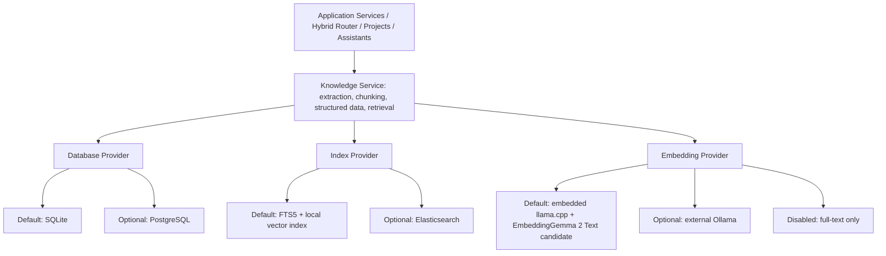
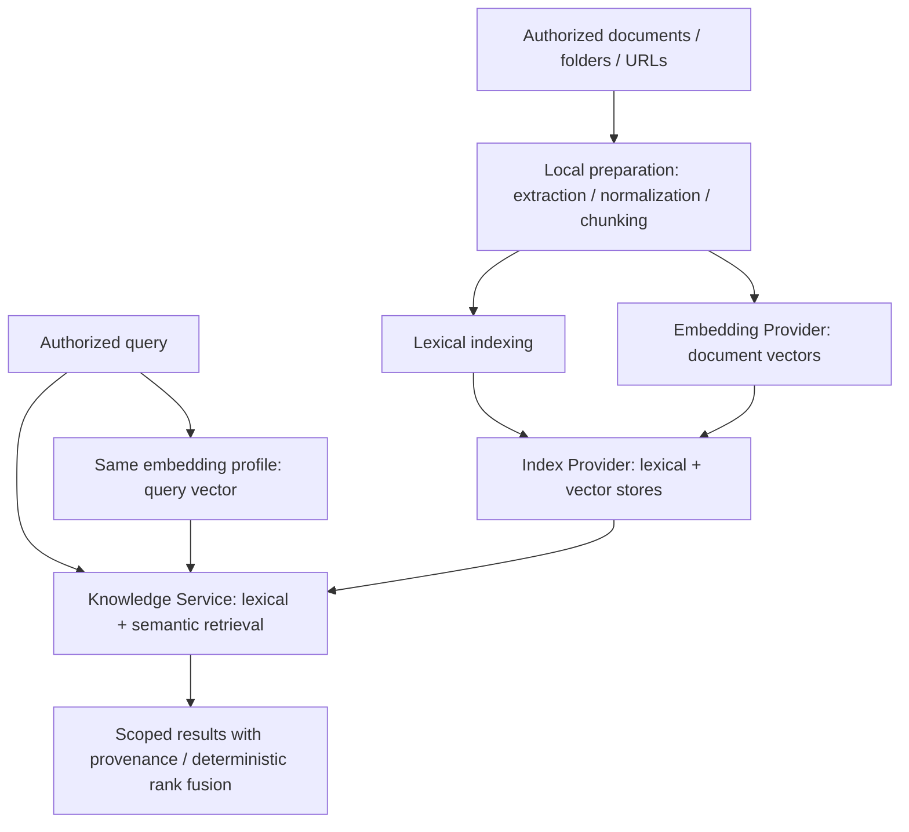

# RC10 — Pluggable Data & Knowledge Infrastructure

**Approved planning scope — NOT IMPLEMENTED.** Updated 2026-11-27. Target v1.1.0-rc.10, subject to gates. SIAAS-FLOW-01 phase B. Depends on RC9 #47, RC8 #46, RC7 #45 and RC6 #44; rebase/reconcile and retarget to final develop only after upstream RC9 acceptance/publication. Never merge RC10 into RC9 or modify upstream branches.

## 1. Product boundary and explicit exception
Free, MIT, local-first, no mandatory Ollama, Docker, cloud, accounts or paid services. The maintainer explicitly approved optional remote database and index providers in RC10; this is a narrow exception to current AGENTS/CONTRIBUTING local-only persistence and PostgreSQL prohibitions, not permission for automatic transfers or remote inference. An optional external Ollama embedding endpoint may run on the same host or an explicitly authorized self-managed remote host; this is a separate narrow exception for embedding inference only, not a change to generative-model policy. In phase C review/update the conflicting policies explicitly with the implementation; do not relax unrelated safeguards. Default installation sends no records or document content to remote providers. No new user-facing object type, second execution core, mandatory external service or CLI implementation. An internal, Personal-managed native embedding worker is permitted; it is not a second application executor or public listener. No remote original-file storage, multi-client shared workspace, synchronization, multi-tenancy or automatic cross-project sharing.

## 2. Global Personal Settings (UI only)
Database: required, Embedded (SQLite) default / Remote (first adapter PostgreSQL). Index Engine: enabled by default; Embedded (SQLite FTS5 + local vectors) default / Remote (first adapter Elasticsearch); independent of database selection. Remote settings: provider, endpoint/database or namespace, provider-specific auth, validated TLS/trust, bounded timeouts, Test Connection (no content transmission), status and explicit Save/activate/migrate confirmation describing destination and data categories. No arbitrary plugin execution or unauthenticated non-loopback services. Local bootstrap configuration and secrets stay local, OS secure storage or fail closed; no passwords/keys in logs, templates, URLs or MCP responses. UI-only mutation, CLI read-only lifecycle shortcut. One active database and one active index per profile; no project/assistant provider overrides. Project policies and assistant sources/retrieval restrictions remain. Disable index pauses/cancels jobs, prevents index retrieval and preserves data; deterministic structured analysis and non-knowledge tasks remain available. Remote unavailable: explicit degraded/error state, never silent fallback or divergent database. Recovery UI available even if database offline.

### Third independent provider: Embedding Provider — approved 2026-11-27

| Provider | Default | Optional alternative |
| --- | --- | --- |
| Database | Embedded SQLite | PostgreSQL |
| Index | Embedded SQLite FTS5 + local vector index | Elasticsearch; Disabled |
| Embedding | Personal-managed embedded llama.cpp runtime + EmbeddingGemma 2 Text (provisional model candidate) | External Ollama; Disabled (lexical only) |
| Retrieval mode | Hybrid when compatible vectors are ready | Lexical only; semantic where supported |

The embedded mode is selected by default, independently of the generative LLM configuration. SIAAS must provide working local semantic search without Ollama once its verified model is installed. Proposed runtime: pinned llama.cpp native library or private managed subprocess; proposed model: EmbeddingGemma 2 Text GGUF, Q8_0, native dimensions (verify exact artifact, model identity, license, checksum, architecture support, tokenizer, pooling, query/document prompts and dimensions during WP01/WP04 before selecting final default). Do not assume previous benchmark or model availability claims are verified. If the candidate fails native/quality/resource gates, benchmark compatible alternatives (EmbeddingGemma original, Qwen3 Embedding 0.6B, BGE-M3 where feasible) and document the proposed replacement for maintainer review. No generative model is bundled or required by this provider.

UI-only global provider selection: Embedded / External Ollama / Disabled; independent of Database and Index settings. Embedded status, model/version/digest, disk needs, model availability, install/remove controls and progress; default model selected, no mandatory or silent download. Prefer explicit user-approved managed download with pinned origin, license notice, SHA-256 integrity verification, atomic install and offline reuse; final installer/bundle choice at acceptance. Native binaries must be pinned, integrity-checked and packaged for supported Windows/macOS/Linux architectures; bounded CPU threads, memory, batch, queue, timeouts and cancellation, lazy load/unload, lifecycle cleanup, no public listener, no arbitrary execution of downloaded content. CPU-only must work; optional hardware acceleration only when validated.

External Ollama is user-managed, independently configurable (endpoint, compatible installed embedding model, capability test, timeouts, status). No automatic start/install/pull. Loopback default endpoint if this optional mode is chosen; remote self-managed endpoints require explicit destination/data-category authorization, validated TLS/auth where applicable, no unauthenticated non-loopback or silent transfers. Test Connection uses no real content. Preserve secret isolation, redirect/SSRF protections and per-project/source authorization. Generative Ollama settings and policy remain independent.

EmbeddingProvider contract: health/capabilities, model profile, embedDocuments/embedQuery, bounded batch/cancellation and structured failures; persist model artifact digest/version, provider/runtime identity, dimension, normalization, pooling, tokenizer/preprocessing and query/document mode in index generation metadata. Do not mix incompatible profiles; provider/model/dimension changes stage vector-only regeneration and atomically activate a validated generation. Lexical index/extraction remain intact. Missing model, disabled provider, unsupported hardware or runtime outage: explicit degraded status and lexical-only retrieval on the selected working index, never silent switch to Ollama/remote provider or automatic reconfiguration. No index retrieval if the index itself is disabled/unavailable. No provider settings or derived vectors in templates/ZIP/MCP provisioning.

Structured Excel/CSV analysis retains its deterministic engine. No new multimodal embedding scope in RC10; text retrieval only, future modalities require separate review.

## 3. Data and service contracts
Audit final RC9 implementation: current LocalDatabase uses synchronous node:sqlite, SQL/PRAGMA, files, chunk matching and relational ownership; knowledge process and retrieval have direct dependencies. Inventory all callers including structured datasets, gateway, skills, append-only trace, compaction, checkpoints, OAuth and headless runtime. Introduce asynchronous application repository/transaction interfaces and backend-specific migrations; no SQLite SQL leaking across adapters, no unrestricted query API. Preserve atomicity, IDs, FK/cascades, ownership, compare-and-set, ordering and idempotency. SQLite embedded adapter preserves existing profile. PostgreSQL adapter uses a least-privilege dedicated database/schema, parameterized SQL, bounded pooling and TLS verification; no superuser requirement, no automatic provisioning of external servers. Keep client authentication/security bootstrap local where needed; audit state allocation explicitly and preserve revocation. Database owns authoritative records (projects, assistants, actions, skills, conversations, templates, permissions, source metadata, structured data, execution trace, session recovery); original files/linked paths stay local. Index is derived, disposable and rebuildable; separate physical SQLite index store so DB/index combinations are independent. Retain locally prepared normalized chunks or reproducible source references with versioned provenance and clear retention; document exactly which metadata/payloads leave device under each mode.

IndexProvider contract: health/capabilities, idempotent scoped upsert/delete, search, status/rebuild, generation activation, bounded cancellation/timeouts; stable chunk/source/version IDs. SQLite FTS5 Unicode/BM25 verify actual packaged support on six targets; keep existing vector cosine baseline until benchmarks justify extensions. Elasticsearch managed index adapter via supported API, explicit version/license/capability matrix and namespace least privilege, lexical + vectors and deterministic rank fusion where appropriate; no dependency on paid features. Qdrant/OpenSearch/Meilisearch are extension candidates, not RC10 mandatory. Existing external indexes: optional bounded read-only adapter only after separate mapping/ownership/embedding compatibility and safety validation; do not promise or implement arbitrary existing-index write access. No arbitrary endpoint as universal provider. Use structured capability negotiation and reject unsupported modes.

## 4. Preparation, retrieval, lifecycle
Reuse native parsers and structured XLSX/CSV engine; optional local Docling/OCR with verified installation/license, no mandatory downloads, bounded resources. Preserve page/section/offset provenance; never invent citations. Version extractor/chunk policy and source fingerprint. Full-text index persistent, independent from optional embeddings; lexical, semantic and hybrid retrieval through same Knowledge service, bounded deterministic RRF and stable ties; source filters apply before candidate ranking and verify again before returning. Search remote results as untrusted data; never accept returned ownership claims alone. Preserve assistant-level Hybrid Router and optional project orchestration. No duplicate router or RAG pipeline. Dedup extraction/index within project only and only for identical content/version with separate source grants; revoke one grant without deleting others. No cross-project dedup.
Durable indexing jobs in Personal runtime (not UI), bounded concurrency, leases, progress, cancel/retry, crash recovery. Atomic published generation, durable outbox/reconciliation for remote writes (no assumed distributed transactions); tombstones/revocation immediately exclude obsolete results, even if remote delete fails. Source changes, disable/delete, unavailable paths and model change invalidate correct generations; no stale/unauthorized citations. Web refresh manual by default, no automatic site crawling.

## 5. Migration and failure boundaries
SQLite <-> PostgreSQL and embedded <-> remote index switch are separate operations. Preflight schema/capability/space, explicit data transfer consent, verified backup, quiesce desktop/headless writers/jobs, stage copy/rebuild, validate counts/IDs/relationships/checksums/event order and ownership, atomic bootstrap activation only after success; old store retained, no implicit deletion. Resumable operation journal, interruption/rollback before cutover and no ambiguous dual-write; post-cutover rollback must account for new writes, never silently lose them. Local single-profile runtime lease; no concurrent clients sharing a remote DB profile. Index may rebuild after migration; no stale content returned. Recover settings safely offline without exposing raw credentials. Backup/restore, deletion and remote retention limitations documented.

## 6. RC7/8/9 integration
Reuse project Tool Permission Gateway (Allow/Ask/Deny) and assistant scope; remote transfers require explicit UI approval independent of tool Allow. Knowledge search/read/status proposed scoped read capabilities; refresh/reindex Ask, deletion guarded; unattended Ask awaits durable approval or denies. OAuth/client/project/assistant/source scope intersection and revocation at each effect; MCP never edits provider settings, reads credentials, accesses raw DB, arbitrary paths or bypasses gateway. Expose bounded authorized knowledge search/list/read/status and refresh if permitted through existing runtime, no second executor. Trace metadata only (IDs/version/timing/outcome, no raw payload/secret); same append-only event store and RC8 recovery semantics. Preserve event order, snapshot lineage and no replay of ambiguous non-idempotent effects. CLI unchanged unless compatibility requires a reviewed lifecycle-only change.

## 7. Work packages and integration
1. RC10-01 final RC9 baseline audit, policy exception, contracts, threat model, storage allocation and migration design.
2. RC10-02 async persistence refactor and SQLite adapter parity; PostgreSQL adapter and migration/backup/recovery.
3. RC10-03 independent index contracts, FTS5 and Elasticsearch managed adapter; capability/namespace checks.
4. RC10-04 preparation, incremental jobs, optional Docling, independent EmbeddingProvider contract, packaged embedded llama.cpp and approved default-model selection/installation, external Ollama adapter, vector profiles/rebuild, hybrid retrieval and explicit lexical degradation.
5. RC10-05 Settings UI for all three independent providers, consent, managed-model status/lifecycle, headless lifecycle, gateway/trace/OAuth/MCP integration.
6. RC10-06 template acceptance fixtures and bilingual documentation. Portable v2 templates never contain connection config, credentials, local paths, data, index or runtime state; coordinate with templates upstream after RC7 template changes, pin only tested catalog.
7. RC10-07 independent integration, benchmarks and native release acceptance. Keep reviewable PRs/diffs; split implementation after final RC9 baseline, not empty PRs now.

## 8. Mandatory gates and evidence
All 2 DB modes x 3 index modes (embedded/remote/disabled); clean RC9 migration and reverse migration, backup/restore, failure at each cutover boundary, offline/unreachable DB/index, no silent fallback, malformed remote responses, permission revocation, cross-project and assistant isolation, remote ACL and credentials/TLS/redirect attacks, stale generation and delete retry, concurrent UI/MCP, headless restart, trace append-only/compaction/recovery, template v1/v2 import/export, no Ollama lexical mode AND real embedded semantic/hybrid mode with no Ollama or Docker, real external Ollama embedding adapter, real PostgreSQL and Elasticsearch supported versions (no mock-only PASS), real MCP client/n8n if applicable. Native six-target FTS5/package/runtime checks; Windows i7 CPU benchmark plus representative Linux/macOS. Compare old lexical scan with 100/1k/10k+ chunks, p50/p95 time, memory/disk, unchanged/changed reindex, quality precision/recall, remote latency and resource overhead; record dataset, exact versions, configuration and raw logs. Establish budgets from baseline before performance claims. Embedding acceptance: real CPU-only embedded inference, offline after verified model installation, six-target native packaging and clean install, missing/corrupt model, interrupted download, unavailable external endpoint, no unauthorized transfer or silent provider switch, profile/dimension mismatch and vector-only rebuild/recovery, query/document preprocessing and retrieval parity. Compare candidate models on reproducible Italian/English PDF, technical and multilingual retrieval fixtures using Recall@5, nDCG@10, p50/p95 latency, indexing throughput, peak RAM and disk; include model/runtime exact digests and quantization. Compare lexical, semantic and hybrid modes. Check applicable licenses/notices and provenance before redistribution. Test valid provider combinations and rejection/degradation of incompatible capabilities; no mock-only readiness. Run all applicable existing unit/typecheck/build/API/UI/E2E/structured/knowledge/actions/templates/distribution/installer/package gates. Evidence under docs/evidence/rc10 with exact commit and PASS/FAIL/BLOCKED/NOT RUN; release gate requires independent review. No publication, merge, tag, workflow activation or external real-data transfer authorized by this planning PR.

## Work handoff (English)
Use SIAAS-FLOW-01 phase C after RC9 is fully integrated, reviewed and published. Read this contract and current AGENTS/CONTRIBUTING; reconcile the stacked RC10 branch to final develop, audit actual RC9, then implement packages 01–07 in dependency order. First establish SQLite parity and safe migrations; then remote providers, index lifecycle, the independent embedded/external embedding providers and integration. Embedded local semantic search without Ollama is a mandatory acceptance path; no default-model claim until real model/runtime evidence exists. Preserve all upstream features and security defaults. Use synthetic fixtures and explicitly provisioned test services, not user data. Do not bypass permissions, publish or merge without separate authorization. Report exact PRs, SHA, diffs, commands, logs, native/real-service evidence and blockers; keep drafts until independently reviewed.

## Cross-channel Knowledge preparation boundary — 2026-11-25
RC5/RC6/RC7 templates and future RC11 ZIP UI/CLI carry only public HTTP(S) URL references for Knowledge, never local documents/folders/paths or cached content. RC9 MCP and future RC11 native Builder may associate supported authorized local file/folder references and public URLs through shared services. No channel imports downloaded/extracted content, indexing metadata, chunks, embeddings, full-text indexes or provider configuration; no binary transfer is implied by these configuration flows. Existing template URL registration and normal destination preparation are preserved; future ZIP validates/ previews without fetching and, after authorized creation, follows normal destination policy. One destination-owned preparation/index engine handles source lifecycle, provenance, scope, incremental indexing, and optional local embeddings. Structured Excel/CSV analysis stays with the structured data engine. Provider selection and remote transfer consent remain Personal Settings, never supplied by provisioning. Test equivalent authorized source registration, isolation, denied remote transfer and no imported derived state. No new RC10 scope for ZIP or builder implementation; see RC9 #47 and RC11 #50.
