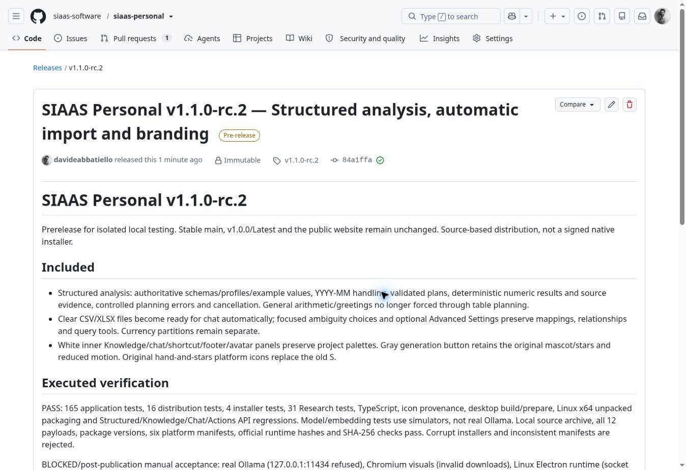

# RC2 publication report / Rapporto di pubblicazione RC2

Published **2026-10-28 at 14:55:41 Europe/Rome** as an immutable GitHub prerelease:
https://github.com/siaas-software/siaas-personal/releases/tag/v1.1.0-rc.2

Release ID 426735035; `draft=false`, `prerelease=true`, `immutable=true`.
Release/tag commit: **84a1ffab4e5f339519bc80844d88ddcd573f561f**.
Policy: [permanent RC publication authorization](../rc-publication-policy.md).
No outstanding mandatory publication blocker. Manual acceptance remains below.

## Changes and root causes

- RC1 structured planning was applied to every message when tables existed, with
  a policy too broad for numerical questions. General arithmetic/greetings now
  bypass table planning; other general/document/mixed intents remain model-assisted.
- Catalog lacked bounded value examples and YYYY-MM semantics. Authoritative IDs,
  display names, mappings, revision, worksheets, partitions and profiles now reach
  the planner. No stale mapping or dataset-ID mismatch was established as the cause.
- Unverified model clarification and a free-form explanation could contradict actual
  schema/results. Numeric output now comes from validated deterministic execution;
  clarification identifies authoritative columns. Unknown operands are validated
  even after filtering to zero rows. File/sheet/columns/filter/aggregation evidence persists.
- Planning errors distinguish unavailable models, transport, invalid JSON, incomplete
  responses, timeout and cancellation. Planning already used think:false, schema JSON
  and 16,384 context in RC1; those were not missing. Streaming chat now requests
  think:false. The original timeout was retained, not arbitrarily increased.
- The precise RC1 Qwen3 CPU planner-unavailable trigger remains unverified in the
  absence of real local inference. This is a declared manual acceptance limitation,
  not a claim that every original Windows failure was reproduced and proven fixed.
- Unambiguous CSV/XLSX imports automatically detect headers/types/partitions, discover
  worksheets and persist ready metadata. Focused choices handle ambiguities; joins
  require semantic confirmation. Advanced Settings retains the technical controls.
- Inner panels are white and generation is gray while project palette logic and
  functional colors remain. Official SVG-derived PNG/ICO/ICNS replace the old S;
  original animated stars and reduced-motion rules are retained.

## PRs and commits

| PR | Purpose | Merge commit |
| --- | --- | --- |
| [#7](https://github.com/siaas-software/siaas-personal/pull/7) | Structured analysis | 0ea75ff9ae28acf53ab3f65b3a6b139ebaf74de8 |
| [#8](https://github.com/siaas-software/siaas-personal/pull/8) | Automatic import | f4555102f3da3057700d19cddc6e19a78ac897aa |
| [#9](https://github.com/siaas-software/siaas-personal/pull/9) | UI/branding | edf5162cae9d069971e866647960791294e30bcd |
| [#10](https://github.com/siaas-software/siaas-personal/pull/10) | RC2 version/policy/distribution verifier | 84a1ffab4e5f339519bc80844d88ddcd573f561f |

All four merged through develop with protections intact. Release branch
`release/1.1.0-rc.2` and tag point to the final integrated commit above.
This post-publication evidence document does not change that immutable release.

## Executed results

| Check | Result |
| --- | --- |
| Application suite | PASS 165/165 |
| Distribution suite | PASS 16/16 |
| Installer suite | PASS 4/4 |
| Research adapter/lifecycle fixtures | PASS 31/31 |
| TypeScript, icons, template check, desktop build/prepare | PASS |
| Linux x64 unpacked packaging, RC2 package version and branding bytes | PASS |
| Structured/Knowledge/Chat/Actions API regressions | PASS with simulated inference/embeddings |
| Source generation, archive-to-commit match, six JSON/TSV manifests and runtime hashes | PASS |
| Corrupt installer and manifest inconsistency rejection | PASS |
| Published tag commit, prerelease flags, asset count and digest metadata | PASS |
| Anonymous downloads of all 12 assets and byte-for-byte comparison | PASS |
| Installer manifests resolve the exact RC2 source asset and version | PASS; not a native installation claim |
| Stable Latest remains v1.0.0; main remains 1bce852cabbefb2459aeafc5aa42146eabd6283b | PASS |
| Real Ollama | BLOCKED: localhost:11434 refused |
| Actual Chromium visual testing | BLOCKED: invalid/unavailable browser download |
| Packaged Linux launch | BLOCKED: environment socket restriction |
| Native Windows packaging/icon/installation | BLOCKED: no Windows host |
| Native macOS and real cross-platform installation/update/rollback | NOT RUN |

Research initially lacked the optional service's test dependencies. Installing its
existing lockfile dependencies resolved the setup failure and all 31 tests passed.
No failing mandatory test was waived. Tests overlap across suites; counts must not
be summed into a claim of distinct tests. The 35 EUR acceptance uses the real engine
with simulated planning, not real Qwen3 inference. No actual app visual PASS is claimed.

Logs: [release checks](../evidence/rc2-release/) and
[anonymous-download verification](../evidence/rc2-release/published-downloads.txt).
No blocked environment test was retried after the explicit exemption policy.

## Assets and integrity

The release contains 12 uploaded payloads plus GitHub's 2 automatically generated
source links. Installers use the named ZIP, not those automatic source archives.
All uploaded files were checked before immutable publication and downloaded again
without authentication after publication. The SHA-256 file covers 11 payloads;
GitHub's digest independently covers the SHA-256 file itself.

| Asset | Bytes | SHA-256 |
| --- | ---: | --- |
| install-rc.ps1 | 5985 | `dcd64f5c4261800c244690c3396c8973ba6e14422087846d4bb9fb7957fefc24` |
| install-rc.sh | 5464 | `d54e23d62b23e6d2f5a8e0d114d175dbdb2d0965a4d0deef2e2ae9327548a08c` |
| install-siaas.ps1 | 5576 | `bd563fcf65b26ac51a1a3fd4c1d4d007876f995dbf0db0dbfd37e95b3220ccf7` |
| install-siaas.sh | 5018 | `da57e1652bd371126ae836346a81bdf70a6118e4ecff00dbd7064bcbb1b660e3` |
| rc-manifests.json | 4053 | `63f28858e5fc0c5c9e25be81730b4beb898489d856bef9e15cf2203e01c42305` |
| rc-manifests.tsv | 2488 | `e793d47fc28984e9287ccce6ab89916783222c13b9e564af579e9292564a6425` |
| READINESS.md | 6049 | `b09bb7476922af2d39ef80ff1353dfccfbd7836bd7c608519af91d50042de8dd` |
| RELEASE_NOTES.md | 6357 | `51e649b8ca3efdce3d5a79cac73e80011c023fc80921e4b8282a521d4d127768` |
| SHA256SUMS.txt | 950 | `7cc6fbe3fb5267415b7d0b5421b02ef2e1b1d4d75386833cd725284bbda64fb1` |
| SIAAS-Personal-1.1.0-rc.2-install.json | 80 | `8af8fd8c789c9cf02d5887ff2b1c2719e94fbe1a51c4466bce5770c37bcdaab7` |
| SIAAS-Personal-1.1.0-rc.2-source.zip | 960426 | `d567f74b92831e77d0764368619df0382768b2f5eeeb86d4e5690d26024d131e` |
| WINDOWS_TESTING.md | 8287 | `8c0f4ffcfebc310116b2e4f3d934cf3433a528cc47433718255aeb05796b2d50` |


## Windows installation and launch

Close RC1/RC2 before updating, and back up the closed RC profile if it already
exists. Do not use the stable profile. These commands target the published RC2
installer and verify its actual released digest before execution. They do not
bypass PowerShell execution policy. Native Windows execution remains manual.

```powershell
$SiaasRcRoot = Join-Path $env:LOCALAPPDATA 'SIAAS Personal RC Source'
$SiaasScript = Join-Path $env:TEMP 'siaas-install-rc2.ps1'
Invoke-WebRequest 'https://github.com/siaas-software/siaas-personal/releases/download/v1.1.0-rc.2/install-rc.ps1' -OutFile $SiaasScript
if ((Get-FileHash $SiaasScript -Algorithm SHA256).Hash.ToLowerInvariant() -cne 'dcd64f5c4261800c244690c3396c8973ba6e14422087846d4bb9fb7957fefc24') { throw 'Installer checksum mismatch' }
$env:SIAAS_RELEASE_TAG = 'v1.1.0-rc.2'
$env:SIAAS_INSTALL_DIR = $SiaasRcRoot
& $SiaasScript
if ($LASTEXITCODE -ne 0) { throw 'RC2 installation failed' }
& (Join-Path $SiaasRcRoot 'launch-rc.cmd')
```

The existing source manager stages versions and retains the previous matching
runtime for rollback. Distribution fixtures test this behavior, including failed
updates and retained profile data; real native update/rollback remains NOT RUN.
The RC profile stays at `$SiaasRcRoot\profile`, separate from stable `%APPDATA%\SIAAS`.

## Manual RC acceptance checklist and limits

Use [the full Windows checklist](../windows-rc2-testing.md): no-click budgets.csv
import and all three Italian questions → 35 EUR; generic 2+2 → 4 with/without
Knowledge; unknown field/invalid plan/timeout; assistant instruction following;
SUM/COUNT/AVG/MIN/MAX, date groups, sorting, duplicates, missing values, worksheets,
confirmed joins, production requirements/shortages and separate finance currencies;
focused ambiguity; optional Advanced Settings; restart/isolation; PDF/RAG, Actions,
Shortcuts/templates; palette switching; white panels; generation/reduced motion;
Windows EXE/taskbar icon and icon caching; installation/update/rollback isolation.

Remaining limitations: exact original real-model failure unverified; model-assisted
routing/performance needs Qwen3 CPU acceptance; mixed results are deterministic
plus separate source excerpts; ambiguous locale numbers/formula caches require
clarification; no silent currency conversion or automatic business-semantic joins.
These are disclosed RC acceptance items, not completed platform tests.



This screenshot verifies GitHub publication only. It is not an application UI
acceptance screenshot. The annotated user reference and private files were not
uploaded. No website deployment or stable release occurred.

## Italiano

**RC2 pubblicata e verificata.** Tutti i 12 file sono scaricabili senza autenticazione,
con dimensioni, SHA-256 e contenuti identici agli asset preparati. Tag e manifest
puntano alla versione esatta. Main è invariato e Latest resta v1.0.0. PR #7–#10
integrate rispettando GitFlow; policy permanente registrata nel repository.

Nessun blocco residuo nei gate obbligatori di pubblicazione. Ollama reale, test
visivi e piattaforme indisponibili restano BLOCKED/NOT RUN e richiedono il collaudo
manuale previsto. Il report non equipara i test simulati a una prova reale Qwen3,
né il packaging Linux a una verifica dell'eseguibile Windows.


## Post-RC2 audit of PR #6 — 2026-10-28

### Scope, gate and fixed comparison points

PR [#6](https://github.com/siaas-software/siaas-personal/pull/6) initially and at
this checkpoint is **OPEN, DRAFT, NOT MERGED**: `release/1.1.0-rc.1` → `main`.
It contains 14 commits and 74 changed files. Issue comments, inline comments and
reviews were empty at inspection. No existing review discussion was discarded.

The RC2 publication gate passed before any repository write: GitHub release
426735035 exists, `draft=false`, `prerelease=true`, `immutable=true`, with all
12 uploaded assets and SHA-256 metadata. The protected tag resolves directly to
`84a1ffab4e5f339519bc80844d88ddcd573f561f`, matching the published provenance.
Source ZIP digest is `d567f74b92831e77d0764368619df0382768b2f5eeeb86d4e5690d26024d131e`.
The published test logs and anonymous-download evidence above were inspected;
mandatory executable checks passed at publication, and unavailable platform/model
checks were accurately marked BLOCKED/NOT RUN. These are historical results,
not fresh execution claims for this audit.

| Reference | Audited commit |
| --- | --- |
| PR #6 / protected immutable RC1 tag | `188f388b51c26831648311d31ab8c1381a5e02e9` |
| PR #6 merge base with RC2 | `b30bab0a0102c6663eb3b4862c331f6fcc03e2c5` |
| Published RC2 | `84a1ffab4e5f339519bc80844d88ddcd573f561f` |
| develop before audit documentation | `8f159b8561e381c7ecdc43e4ae2b54fedc96bb1a` |
| main / stable v1.0.0 | `1bce852cabbefb2459aeafc5aa42146eabd6283b` |

### Commit and patch comparison

13 of 14 PR commits are exact ancestors of RC2/develop. The RC1 head itself is
**not** an ancestor. `git cherry v1.1.0-rc.2 origin/release/1.1.0-rc.1` reports only
`+ 188f388...`. Its four-file patch was inspected rather than treating that plus
sign as missing application functionality: it only changes package versions and
adds CHANGELOG.md and historical release notes. No rebased/cherry-picked runtime
patch needs recovery. Main intentionally remains the stable baseline; differences
from main do not justify merging a prerelease preparation PR into it.

| Commit | Purpose | Disposition |
| --- | --- | --- |
| [`b31e8b8`](https://github.com/siaas-software/siaas-personal/commit/b31e8b8db6db9aae1a5c75c50fc5d4898bf057bb) | Merge pull request #3 from siaas-software/main | PRESERVED: ancestor of RC2 and develop. |
| [`b76f6ff`](https://github.com/siaas-software/siaas-personal/commit/b76f6ff5f547d2f5833df34877d78af911ed9b65) | feat: add local structured data analysis and official planning templates | PRESERVED: ancestor of RC2 and develop. |
| [`b6de863`](https://github.com/siaas-software/siaas-personal/commit/b6de863949cae8ea3a4531fb6ffbb644a2b8bcd5) | docs: consolidate draft analysis guidance and licensing evidence | PRESERVED: ancestor of RC2 and develop. |
| [`fb4e111`](https://github.com/siaas-software/siaas-personal/commit/fb4e111f1bbb3ea3faecaa31cf0302519a5a1048) | fix: patch runtime dependencies and harden parser and archive distribution | PRESERVED: ancestor of RC2 and develop. |
| [`149413f`](https://github.com/siaas-software/siaas-personal/commit/149413fb685e54c0c8a0679f6f32960aa5c073c7) | docs: reconcile implementation and prepare coordinated 1.1.0 release gates | PRESERVED: ancestor of RC2 and develop. |
| [`5b81e4d`](https://github.com/siaas-software/siaas-personal/commit/5b81e4da87f6e2fef74e4c2e6c0e2fb6b1881085) | fix: retain complete license notices for every parser dependency | PRESERVED: ancestor of RC2 and develop. |
| [`b1bbba5`](https://github.com/siaas-software/siaas-personal/commit/b1bbba59a67f7f0ad4611ce11a560c7a5e284c8e) | Merge complete parser notices into documentation preparation | PRESERVED: ancestor of RC2 and develop. |
| [`e64c87f`](https://github.com/siaas-software/siaas-personal/commit/e64c87f7a058867de59da8d4384c66fa7465606a) | test: preserve opt-in real analytical chat acceptance | PRESERVED: ancestor of RC2 and develop. |
| [`f09a5c3`](https://github.com/siaas-software/siaas-personal/commit/f09a5c338adf89b4d573c31aea823b146f36244f) | Merge opt-in analytical acceptance test into documentation preparation | PRESERVED: ancestor of RC2 and develop. |
| [`59de009`](https://github.com/siaas-software/siaas-personal/commit/59de009afa72412b8a81bbc24407a9e646c2d896) | Support isolated release candidate installation and adopt curated catalog | PRESERVED: ancestor of RC2 and develop. |
| [`6293a51`](https://github.com/siaas-software/siaas-personal/commit/6293a5192a83c0d79101e9c71e505d9c1d45cfd7) | Finalize product documentation, Windows candidate guide and sample data | PRESERVED: ancestor of RC2 and develop. |
| [`b2981e6`](https://github.com/siaas-software/siaas-personal/commit/b2981e61cde320c6619c0522ff3c66d3946981aa) | Merge pull request #4 from siaas-software/feature/structured-data-analysis | PRESERVED: ancestor of RC2 and develop. |
| [`b30bab0`](https://github.com/siaas-software/siaas-personal/commit/b30bab0a0102c6663eb3b4862c331f6fcc03e2c5) | Merge pull request #5 from siaas-software/feature/documentation-license-audit | PRESERVED: ancestor of RC2 and develop. |
| [`188f388`](https://github.com/siaas-software/siaas-personal/commit/188f388b51c26831648311d31ab8c1381a5e02e9) | Prepare 1.1.0-rc.1 source release candidate and acceptance notes | Split: RC1 versions obsolete/superseded; changelog recovered; historical notes retained by RC1 tag. |

### File comparison and dispositions

All 74 PR paths have identical RC2/develop state at the audited snapshots:
51 are byte-identical to PR #6, 21 have reviewed RC2 replacements/additions and
2 RC1-only documents are absent. No PR application, distribution, licensing or
sample-data file was removed. Existing PR #4/#5 implementation is retained;
PRs #7–#10 supply the replacements detailed below. RC2 → develop adds only the
publication report, screenshot and anonymous-download log.

| PR #6 path | Classification | main comparison | Evidence / reason |
| --- | --- | --- | --- |
| `CHANGELOG.md` | MISSING → correction | absent | Restore exact RC1 bullet list plus RC2 index; verified historical tag link. No runtime change. |
| `CONTRIBUTING.md` | PRESERVED | older/different | Exact blob match in RC2 and develop. |
| `README.md` | SUPERSEDED | older/different | RC2 notes, policy and honest acceptance limits added (#10). |
| `THIRD_PARTY_NOTICES.md` | PRESERVED | older/different | Exact blob match in RC2 and develop. |
| `desktop/install-ollama.cjs` | PRESERVED | older/different | Exact blob match in RC2 and develop. |
| `desktop/safe-zip.cjs` | PRESERVED | absent | Exact blob match in RC2 and develop. |
| `docs/installation-en.md` | PRESERVED | older/different | Exact blob match in RC2 and develop. |
| `docs/installation-it.md` | PRESERVED | older/different | Exact blob match in RC2 and develop. |
| `docs/licensing/audit-2026-10-24.md` | PRESERVED | absent | Exact blob match in RC2 and develop. |
| `docs/licensing/dependency-inventory.json` | PRESERVED | absent | Exact blob match in RC2 and develop. |
| `docs/licensing/morphic-dependency-inventory.json` | PRESERVED | absent | Exact blob match in RC2 and develop. |
| `docs/licensing/notices/README.md` | PRESERVED | absent | Exact blob match in RC2 and develop. |
| `docs/licensing/notices/dm-sans-OFL.txt` | PRESERVED | absent | Exact blob match in RC2 and develop. |
| `docs/licensing/notices/lucide-feather-LICENSE.txt` | PRESERVED | absent | Exact blob match in RC2 and develop. |
| `docs/licensing/notices/manrope-OFL.txt` | PRESERVED | absent | Exact blob match in RC2 and develop. |
| `docs/licensing/notices/saxes-5.0.1-LICENSE` | PRESERVED | absent | Exact blob match in RC2 and develop. |
| `docs/release-readiness-1.1.0.md` | PRESERVED | absent | Exact blob match in RC2 and develop. |
| `docs/releases/1.1.0-rc.1.md` | SUPERSEDED | absent | Current acceptance covered by RC2 notes/readiness; complete RC1 document preserved under immutable v1.1.0-rc.1, linked from restored changelog. |
| `docs/security-readiness-2026-10-25.md` | PRESERVED | absent | Exact blob match in RC2 and develop. |
| `docs/structured-data-analysis-preview.md` | PRESERVED | absent | Exact blob match in RC2 and develop. |
| `docs/structured-data-analysis-report.md` | PRESERVED | absent | Exact blob match in RC2 and develop. |
| `docs/structured-data-analysis.md` | SUPERSEDED | absent | Automatic readiness, clarification, stable IDs and grounded answers replace RC1 instructions (#7/#8). |
| `docs/windows-rc-testing.md` | PRESERVED | absent | Exact blob match in RC2 and develop. |
| `examples/structured-analysis/README.md` | SUPERSEDED | absent | Automatic import replaces mandatory mapping confirmation (#8); fixture bytes preserved. |
| `examples/structured-analysis/budgets.csv` | PRESERVED | absent | Exact blob match in RC2 and develop. |
| `examples/structured-analysis/duplicates.csv` | PRESERVED | absent | Exact blob match in RC2 and develop. |
| `examples/structured-analysis/operations.xlsx` | PRESERVED | absent | Exact blob match in RC2 and develop. |
| `examples/structured-analysis/orders.csv` | PRESERVED | absent | Exact blob match in RC2 and develop. |
| `examples/structured-analysis/transactions.csv` | PRESERVED | absent | Exact blob match in RC2 and develop. |
| `next.config.ts` | PRESERVED | older/different | Exact blob match in RC2 and develop. |
| `package-lock.json` | SUPERSEDED | older/different | RC2 package versions and icon tooling metadata; runtime dependency versions retained (#9/#10). |
| `package.json` | SUPERSEDED | older/different | RC2 version, verification/icon commands and development-only icon dependencies (#9/#10). |
| `scripts/build-desktop.mjs` | PRESERVED | older/different | Exact blob match in RC2 and develop. |
| `scripts/build-structured-parser.mjs` | PRESERVED | absent | Exact blob match in RC2 and develop. |
| `scripts/install-rc.ps1` | PRESERVED | absent | Exact blob match in RC2 and develop. |
| `scripts/install-rc.sh` | PRESERVED | absent | Exact blob match in RC2 and develop. |
| `scripts/lib/distribution.mjs` | PRESERVED | older/different | Exact blob match in RC2 and develop. |
| `scripts/license-inventory.mjs` | PRESERVED | absent | Exact blob match in RC2 and develop. |
| `scripts/release-source.mjs` | SUPERSEDED | older/different | Adds notes/readiness/Windows attachments; same source/manifests/checksum flow (#10). |
| `scripts/source-manager.mjs` | PRESERVED | older/different | Exact blob match in RC2 and develop. |
| `scripts/structured-parser.cjs` | PRESERVED | absent | Exact blob match in RC2 and develop. |
| `src/app/api/chat/route.ts` | SUPERSEDED | older/different | General request instructions and combined request cancellation (#7). |
| `src/app/api/documents/[id]/process/route.ts` | PRESERVED | older/different | Exact blob match in RC2 and develop. |
| `src/app/api/documents/route.ts` | PRESERVED | older/different | Exact blob match in RC2 and develop. |
| `src/app/api/local/structured/route.ts` | SUPERSEDED | absent | Adds clarification and non-executable relationship suggestions; original actions retained (#8). |
| `src/app/globals.css` | SUPERSEDED | older/different | Additive scoped white panels and gray generation state (#9). |
| `src/components/local-knowledge.tsx` | PRESERVED | older/different | Exact blob match in RC2 and develop. |
| `src/components/structured-knowledge.tsx` | SUPERSEDED | absent | Automatic summary/clarification; mappings, relationships, query editor and downloads retained in Advanced Settings (#8). |
| `src/components/workspace.tsx` | SUPERSEDED | older/different | Accessible generation busy state; existing workspace retained (#9). |
| `src/generated/builtin-templates.json` | PRESERVED | older/different | Exact blob match in RC2 and develop. |
| `src/lib/agent-steps.ts` | PRESERVED | older/different | Exact blob match in RC2 and develop. |
| `src/lib/catalog.ts` | PRESERVED | older/different | Exact blob match in RC2 and develop. |
| `src/lib/http.ts` | PRESERVED | older/different | Exact blob match in RC2 and develop. |
| `src/lib/local/agent.ts` | SUPERSEDED | older/different | General chat instruction added; dataset tools/scoping retained (#7). |
| `src/lib/local/database.ts` | PRESERVED | older/different | Exact blob match in RC2 and develop. |
| `src/lib/structured/chat.ts` | SUPERSEDED | absent | Validated result and cited excerpts replace unbounded model explanation; general routing and cancellation (#7). |
| `src/lib/structured/engine.ts` | SUPERSEDED | absent | Validates operands even for zero rows; adds readable names/partition metadata (#7). |
| `src/lib/structured/parser.ts` | PRESERVED | absent | Exact blob match in RC2 and develop. |
| `src/lib/structured/planner.ts` | SUPERSEDED | absent | Authoritative bounded local examples, YYYY-MM, error/cancellation handling; same schema validation and 60s timeout (#7). |
| `src/lib/structured/profile.ts` | SUPERSEDED | absent | Explicit DMY/MDY clarification and reviewed columns; currency and invalid-value safeguards retained (#8). |
| `src/lib/structured/service.ts` | SUPERSEDED | absent | Readable result columns and exact single-measure/unit summary; evidence retained (#7). |
| `src/lib/structured/store.ts` | SUPERSEDED | absent | Automatic mappings and stable worksheet IDs; source refresh invalidates joins, explicit semantic join confirmation (#8). |
| `src/lib/structured/types.ts` | SUPERSEDED | absent | Additive optional clarification metadata; previous mapping fields retained (#8). |
| `templates-source.json` | PRESERVED | older/different | Exact blob match in RC2 and develop. |
| `tests/distribution.test.mjs` | PRESERVED | older/different | Exact blob match in RC2 and develop. |
| `tests/project-flows.mjs` | PRESERVED | older/different | Exact blob match in RC2 and develop. |
| `tests/real-ollama-smoke.mjs` | PRESERVED | absent | Exact blob match in RC2 and develop. |
| `tests/real-structured-api.mjs` | SUPERSEDED | absent | Evidence assertion replaces removed AI explanation assertion; real-model test retained but NOT RUN (#7). |
| `tests/safe-zip.test.cjs` | PRESERVED | absent | Exact blob match in RC2 and develop. |
| `tests/source-manager.test.mjs` | PRESERVED | older/different | Exact blob match in RC2 and develop. |
| `tests/structured-api.mjs` | SUPERSEDED | absent | Checks zero-click CSV/XLSX readiness, partitions, grounded evidence and general arithmetic bypass (#7/#8). |
| `tests/structured-bundle.test.mjs` | PRESERVED | absent | Exact blob match in RC2 and develop. |
| `tests/structured.test.ts` | PRESERVED | absent | Exact blob match in RC2 and develop. |
| `tests/template-sources.test.ts` | PRESERVED | older/different | Exact blob match in RC2 and develop. |

### Missing, obsolete and uncertain items

- **MISSING, corrected by this documentation change:** current release-history
  index (`CHANGELOG.md`). Purpose: summarize shipped capabilities and link their
  acceptance limits. Impact: loss of discoverable release history, not missing
  runtime functionality. Restore every original RC1 capability bullet exactly,
  add RC2 references, and link complete RC1 notes through their immutable tag.
  Validation checks exact bullet preservation and both current/historical targets.
- **SUPERSEDED:** RC1 release notes are not copied into current documentation.
  RC2 notes/readiness/Windows guidance describe current behavior; the full RC1
  notes remain in protected tag `v1.1.0-rc.1` and the immutable published RC1 assets.
  That tag points to the exact PR head, retaining historical failures, limitations,
  licensing assessment and rollback warnings without depending on the branch.
- **OBSOLETE:** resetting versions to RC1, requiring manual confirmation for every
  unambiguous table, adding an unconstrained AI explanation after verified results,
  and the PR's future stable-promotion merge. Do not reintroduce these behaviors.
- **UNCERTAIN functionality:** no unresolved PR change was identified by the
  ancestry/blob/semantic comparison. Fresh full application validation remains
  BLOCKED below; this is an execution limitation, not a PASS or proof of real
  Qwen3/Windows acceptance. No new candidate is needed for this docs-only recovery.

### Security, distribution and branch dependencies

RC installers, source manager, distribution validation, archive extraction,
parser bundle, dependency notices and baseline regression files are exact blob
matches. Inspected safeguards include explicit candidate tag selection, strict
source/runtime URL and hash checks, separate RC roots/profiles, staged updates,
failed-build preservation and paired runtime rollback. Structured source changes
still invalidate relationships; currency partitions, original documents and scoped
assistant access remain protected. No Docker/cloud/auth dependency was introduced.

Searches of current scripts, docs, README and .github found no operational
`release/1.1.0-rc.1` branch reference. Historical Windows instructions use the
immutable `v1.1.0-rc.1` tag. RC installers resolve release assets by exact tag;
rollback uses retained installed versions/runtimes. RC1's GitHub release retains
its source asset and tag independently of its descriptive target_commitish.
At inspection PR #6 was the only open PR. These checks support eventual branch
removal, but the branch is retained at this checkpoint while full test replay
remains blocked. Recheck refs and open PRs immediately before any deletion.

### Validation during this audit

Node 24.22.1. The application source at develop is identical to published RC2;
this correction changes documentation only. Results below distinguish fresh
checks from the release-time evidence already listed above.

| Check | Audit result | Evidence / limitation |
| --- | --- | --- |
| Distribution suite | PASS 16/16 | [Fresh log](../evidence/pr6-audit/distribution.txt); mocked downloads and temporary fixture installs, including failed update, RC profile isolation and rollback. No real app installation or Docker execution. |
| Update/profile/rollback regressions | PASS 7/7 | [Fresh log](../evidence/pr6-audit/node-regressions.txt); desktop-updates, product-identity, removed-integrations, source-rollback. |
| Bash syntax | PASS | All scripts/*.sh via bash -n. |
| Source manager/release generator/verifier syntax | PASS | node --check on the three scripts. |
| Template snapshot | PASS | templates check, pinned d2ab4cd0afacbfdc109a95a9890d761ec7dd1af4. |
| Markdown local targets | PASS | 68 local Markdown file targets checked after correction, including changelog and audit evidence; no missing target. External links not exhaustively crawled. |
| Changelog recovery | PASS | Original RC1 bullets match exactly; RC2 file links and RC1 tagged notes exist. |
| TypeScript, full application/unit/structured/import suites | BLOCKED | tsx, typescript, exceljs and other lockfile dependencies absent; not rerun. Release evidence: 165 application tests and typecheck PASS. |
| Desktop build/prepare/package and API chat/structured/Knowledge/Actions | BLOCKED | next/compiler/parser dependencies and built server absent; not rerun. Published RC2 build/package/API evidence remains historical PASS with simulated Ollama. |
| Installer and ZIP dependency suites; Research | BLOCKED | yauzl and service dependencies absent; not rerun. Release evidence: 4 installer and 31 Research tests PASS. |
| Fresh anonymous asset replay | BLOCKED / partial | Eleven assets downloaded and matched sizes/GitHub SHA-256, including exact source ZIP equality with the tag and all four installer scripts; WINDOWS_TESTING.md replay cancelled by network approval before decision. Prior published-downloads.txt proves all 12 at publication; partial replay is not a new all-assets PASS. |
| Real Ollama, Chromium visuals, Linux Electron runtime, native Windows | BLOCKED | Existing documented environment limitations; not retried, not replaced with simulated PASS. |
| Native macOS and real cross-platform lifecycle | NOT RUN | Existing native-host limitations; no native installation performed. |

Automatic approval review rejected `npm ci --ignore-scripts --no-audit --no-fund`:
AGENTS.md requires explicit informed permission before installation/system changes;
the reviewer did not treat test authorization as dependency-install authorization.
No retry or indirect installation was used. Completing fresh full-suite replay
requires permission to download the existing root and optional Research lockfile
dependencies into this disposable audit checkout (no user-machine app installation,
no global packages, no Docker or paid service). Download replay also needs permitted
network access. The dependency preflight failure is not an application test failure.

### Cleanup outcome and next activity

**PR #6 remains OPEN/DRAFT and unmerged; `release/1.1.0-rc.1` remains intact.**
No stable release, tag movement, asset replacement, protected-branch bypass or
force-push occurred. The documentation correction uses a separate PR to develop.
After its merge, recheck the recovered changelog, complete blocked validation,
post the concise audit summary, close #6 without merge and delete only the obsolete
branch if the dependency/ref checks still pass. Record actual closure/deletion
outcomes here; do not mistake this checkpoint for completed cleanup.

GitFlow ruleset 25665792 remains active on main/develop (PR required, deletion and
non-fast-forward prohibited, no bypass actors). Tag ruleset 25666094 protects v*
against update/deletion/non-fast-forward, with no bypass actors. RC1 and RC2 releases
are immutable. main and release tags were not modified by this audit.

**Phase 1 readiness:** the technical RC2 baseline and existing limitations are
identified, but this requested audit/cleanup is not yet complete because fresh
validation is blocked. Do not claim unconditional readiness or start Phase 1,
Phase 2 or SIAAS CLI Lifecycle as part of this work.
